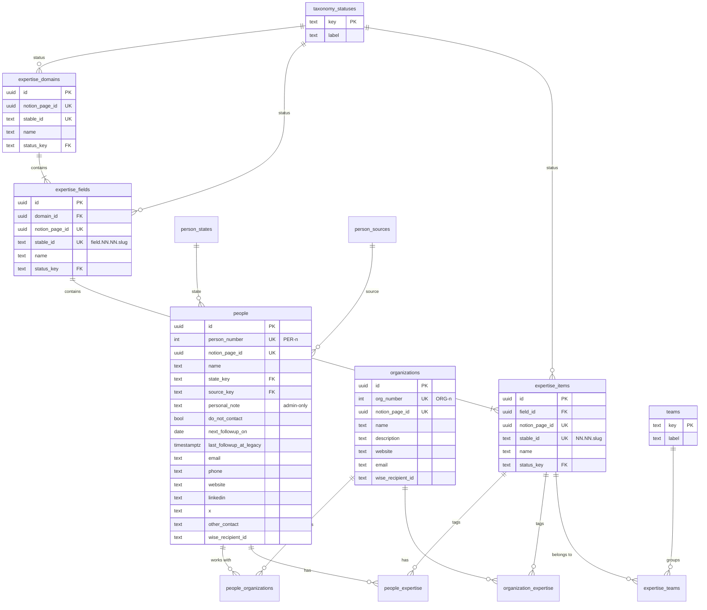
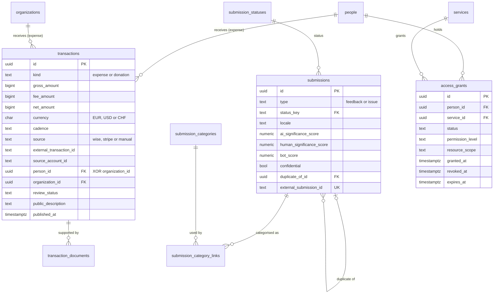

# Data model: Notion → PostgreSQL

Status: **decided** (2026-10-14) for People, Organizations and the
taxonomy (migration 0002, §8); **design only** for the future modules (§6).
Remaining client decisions are listed in [§9](#9-open-questions-for-the-client).

This document maps the client's Notion **"0.1 native"** structure (the
source of truth for the directory; the legacy "Community" database is
ignored) onto the native PostgreSQL schema of the NestJS API, defines how
the Notion import must behave, and sketches the modules that come later.
It follows the client principle for v0.1: built properly and ready to
grow into v1.0, but with no speculative features — anything not asked for
is left out, and anything unclear is an open question rather than a
guess.

Related: [native backend plan](../native-backend-implementation-plan.md)
(§5 database model, §13 unresolved requirements) and
[ADR 013](./decisions/013-nestjs-native-api.md).

## 1. Current schema (migrations 0000 and 0001)

Source: `apps/api/src/*/*.schema.ts` and `apps/api/drizzle/`.

| Table | Purpose | Notes |
|---|---|---|
| `admin_users`, `admin_sessions` | Owner sign-in (0000) | Out of scope here except that admin access gates every directory field below. |
| `people` | People directory | Name, state, source, personal note, do-not-contact, six contact columns, `last_followup_at`. |
| `person_states`, `person_sources` | Editable vocabularies (lookup tables, not enums) | Seeded: states `sourced`, `contacted`, `collaborating`; sources `candide`, `ai`, `contribution_email`, `waitlist`, `notion_import`. |
| `organizations` | Organizations directory | Name, website, note. |
| `people_organizations` | Person ↔ Organization (many-to-many) | Composite PK; deleting either side drops the link only. |
| `expertise_domains` → `expertise_fields` → `expertise_items` | Taxonomy | Name only; names unique among siblings (case-insensitive); a parent in use can't be deleted. |
| `people_expertise`, `organization_expertise` | Person/Organization ↔ Expertise item | Link to the **Expertise level only**; an item in use can't be deleted. |

Conventions already in place, kept for everything below: `uuid` primary
keys (`gen_random_uuid()`), `created_at`/`updated_at` as `timestamptz`,
snake_case, explicit `ON DELETE` on every foreign key, CHECK constraints
for invariants, vocabularies as lookup tables (rows can be added or
relabelled without a destructive migration). Names and emails are
deliberately **not unique** on People and Organizations.

## 2. People

Legend: ✅ exists · ➕ missing · ✏️ needs a change.

| Notion property | PostgreSQL | Status | Notes |
|---|---|---|---|
| Name | `people.name` | ✅ | 1–200 chars. Not unique (duplicates are flagged, see §5). |
| Expertise | `people_expertise` → `expertise_items` | ✅ | Expertise level only. Field and Domain are derived through joins (§4), never stored on the person. |
| Personal note | `people.personal_note` | ✅ | Private, admin-only: served only by the authenticated admin API; must never appear in any public endpoint, export or log. ≤ 5000 chars. |
| Source | `people.source_key` → `person_sources` | ✏️ | Exactly **AI, Candide, Contribution email**. The seeded extras `waitlist` and `notion_import` are removed; people still using them get no source (listed by the migration, §8.1). Provenance of imported records is tracked by the import itself (§5), not by Source. |
| State | `people.state_key` → `person_states` | ✏️ | **Sourced, Contacted, In discussion, Collaborating, On hold, Rejected**, in that lifecycle order (`sort_order`, used by "State ascending"). |
| Organizations | `people_organizations` | ✅ | Many-to-many; same link the Organization's "People" property reads. |
| Do not contact | `people.do_not_contact` | ✅ | `boolean not null default false`. |
| Follow-up date | `people.next_followup_on` | ✏️ | Notion's value is the **next** planned follow-up, and a date. New `next_followup_on date`. The old `last_followup_at` meant something else, so its values are **not** converted: they move to `last_followup_at_legacy` (kept, read-only in the admin) and `next_followup_on` starts empty. |
| Email | `people.email` | ✅ | Shape check `^[^@\s]+@[^@\s]+$`, ≤ 320. Not unique. |
| Phone | `people.phone` | ✅ | ≤ 64. |
| Website | `people.website` | ✅ | ≤ 2048. |
| LinkedIn | `people.linkedin` | ✅ | ≤ 2048. |
| X | `people.x` | ✅ | ≤ 2048. |
| Other contact details | `people.other_contact` | ✅ | ≤ 500. |
| Wise recipient account ID | `people.wise_recipient_id` | ➕ | Free text, ≤ 100 chars, no format assumed. Admin-only. |
| Person ID (PER-n) | `people.person_number` | ➕ | The `n` of `PER-n`: unique, assigned automatically for people created in the admin and **preserved** from Notion on import. `PER-` is display formatting, not stored. Very likely the Figma People table's "Number" column (plan §13 item 1). |
| *(import key)* | `people.notion_page_id` | ➕ | `uuid`, unique when present: the first match key of the import (§5). |

## 3. Organizations

| Notion property | PostgreSQL | Status | Notes |
|---|---|---|---|
| Name | `organizations.name` | ✅ | 1–200 chars, not unique. |
| Description | `organizations.description` | ✏️ | Replaces `note` (same type, ≤ 5000; existing text is kept). Notion has no separate note. |
| Expertise | `organization_expertise` → `expertise_items` | ✅ | Expertise level only. |
| People | `people_organizations` | ✅ | The same link as the person's "Organizations" property — stored once. |
| Website | `organizations.website` | ✅ | ≤ 2048. |
| Email | `organizations.email` | ➕ | Same shape and length checks as `people.email`, not unique. |
| Wise recipient account ID | `organizations.wise_recipient_id` | ➕ | Free text, ≤ 100 chars, admin-only. |
| Organization ID (ORG-n) | `organizations.org_number` | ➕ | Unique, assigned automatically, preserved from Notion; `ORG-` is display formatting. |
| *(import key)* | `organizations.notion_page_id` | ➕ | `uuid`, unique when present. |

## 4. Expertise taxonomy

Three levels, about **14 domains → 120 fields → 750 expertise items**.
People and Organizations link **only to the Expertise level**; a person's
fields and domains are computed with joins
(`people_expertise → expertise_items → expertise_fields → expertise_domains`),
never stored — so moving an item to another field can't leave stale copies
behind. This is how the current admin already reads them.

| Notion property | Domain | Field | Expertise item | Notes |
|---|---|---|---|---|
| Name | `name` ✅ | `name` ✅ | `name` ✅ | Unique among siblings, kept: a second item with the same name in one field is skipped and reported by the import. |
| Parent | — | `domain_id` ✅ | `field_id` ✅ | Required, `ON DELETE restrict`. |
| Stable ID | ➕ | ➕ | ➕ | `stable_id text`, unique when present. Formats below. |
| Status | ➕ | ➕ | ➕ | `status_key` → lookup `taxonomy_statuses`, seeded with **`active`** (the only value in the real data). More values are rows, added without a migration. |
| Teams | — | — | ➕ | Items only: 0..n of **Communication, Compliance, Moderation, Operations, Tech, Treasury** → lookup `teams` + link table `expertise_teams`. Recorded only; nothing uses it yet. |
| *(import key)* | ➕ | ➕ | ➕ | `notion_page_id uuid`, unique when present. |

**Stable ID formats** (enforced by a CHECK; the import cleans and
validates first, §5):

| Level | Format | Real examples | CHECK |
|---|---|---|---|
| Expertise item | `NN.NN.slug` | `07.02.participatory_democracy`, `14.05.sex_work_experience` | `^[0-9]{2}\.[0-9]{2}\.[a-z0-9_]+$` |
| Field | `field.NN.NN.slug` | `field.07.02.…` | `^field\.[0-9]{2}\.[0-9]{2}\.[a-z0-9_]+$` |
| Domain | `domain.NN.slug` | `domain.07.government_democracy_and_public_affairs` | `^domain\.[0-9]{2}\.[a-z0-9_]+$` (migration 0003) |

Slugs are lowercase letters, digits and underscores. An item's `NN.NN`
should equal its field's `NN.NN`, and a field's first `NN` its domain's;
a mismatch is imported anyway and flagged in the import report (a cross-row
rule, kept in the import rather than a trigger).

**The Notion data (inspected 2026-10-14, read-only):** 14 domains, 120
fields, 1105 expertise items — all Active, none archived, every item with
exactly one field, no duplicate names or Stable IDs, no NN mismatches, all
14 domains on `domain.NN.slug` (numbers 01–14). The 1105 (versus ~750 in an
earlier export) are not duplicates or leftovers: every row was created on
2026-09-25, i.e. the taxonomy was rebuilt larger that day (3–19 items per
field, median 10). Status options in Notion: Active, Proposed, Deprecated
(seeded by 0003). Teams on items: Compliance 537, Communication 331,
Tech 235, Treasury 118, Moderation 100, Operations 79 (124 items have none).

**The `http://` bug, explained:** Notion turned the start of many Stable
IDs into links (`04.01.construction` → `http://04.01.construction/`),
splitting the value into text segments — 6 domains, 38 fields, 197 items
(18%). A CSV export shows the link, hence the `http://`. The API's visible
text is correct once every segment is joined, which the importer does
(links ignored); it still strips a typed `http://` as a safety net.

## 5. Notion import rules

The import is a re-runnable copy from Notion into PostgreSQL. Whether it
runs once or repeatedly is Q1. Every run — dry, applied or failed — is
recorded in `import_runs` (migration 0003: kind, started/finished, mode,
counts and issues as JSON, triggered by).

**Built: the taxonomy importer** (`npm run api:import:taxonomy`,
`apps/api/src/import/taxonomy`): dry run by default (full report, writes
only the `import_runs` row); `--apply` writes in one transaction, planned
inside it; `--deprecate-missing` sets rows Notion no longer has to
"deprecated" (never deletes). Order: domains → fields → items → team
links. Parents come from the Notion relation (Field → Domain,
Expertise → Field); a row whose parent isn't imported is skipped, and so
are its children. Unknown Status/Team values are left out and reported.
Only changed rows are written: a second run reports 0 changes. The Notion
client paginates and retries 429/5xx with backoff. People and
Organizations importers come next, with the same rules.

1. **Matching.** A Notion page is matched to an existing row by
   `notion_page_id` first, then — for taxonomy rows — by `stable_id`. No
   other key is used: never name, never email. A page with no match is
   inserted.
2. **Stable ID clean-up.** Join the text segments (Notion's auto-links,
   §4), strip one leading `http://`, trim, then validate against §4. An ID
   that is still invalid is **not stored**; the row is kept (matched by page
   ID) and flagged `invalid_stable_id` with the raw value in the run report.
   A second row with an already-used Stable ID is imported with an empty
   one and flagged `duplicate_stable_id`.
3. **Duplicates.** People and Organizations sharing a name or an email
   (case-insensitive, trimmed) stay separate rows and are **flagged, never
   merged** — in the run report and as a computed "possible duplicate"
   marker in the admin (a query, no stored flag that could go stale). In
   the taxonomy, the first item with a given name in a field is imported;
   later ones are skipped and reported.
4. **No AI.** The import is deterministic code: no model call for matching,
   cleaning, classifying or summarising.
5. **Completeness, not rejection.** Notion properties marked `*` are
   "required for completeness". A missing value never blocks the record;
   it is flagged (`incomplete: <property>`) in the report and shown as
   incomplete in the admin. Which properties carry `*` is Q3. The same
   applies to values the database can't hold (e.g. a malformed email): the
   field is left empty, the record is kept, the raw value is in the report.
6. **No demo data.** A Notion record is skipped and reported
   (`demo_record`) when any of these hold: an email or website on the
   `example.org` domain (or a subdomain), the text "Fictional sample" in any
   text property, or an ID starting with `DEMO-`.
7. **Idempotent.** A second run with unchanged Notion data changes nothing:
   rows are compared by payload hash and only written when a value
   actually differs (so `updated_at` doesn't move either), links are
   reconciled as sets, and PER-n / ORG-n numbers come from Notion. A
   re-run after Notion edits applies exactly those edits.
8. **Order.** Taxonomy first (domains → fields → items → teams), then
   organizations, then people, then the links — so every reference exists
   when it is written. Each run is one transaction: all or nothing.

### No demo data, anywhere

Project rule from 2026-10-14: no mock-up, demo, fake or seeded sample
records in any database — local development, staging or production. Real
records come only from Notion through the import. Small fixtures are
allowed only inside automated tests and are only ever written to `*_test`
databases. The former demo seed (`npm run api:seed:demo`) is removed;
migrations seed vocabulary/lookup rows only (states, sources, teams,
taxonomy statuses). Databases that already hold demo rows are cleaned with
the purge command (`npm run api:purge-demo-data`: dry run by default, a
confirmed run needs a fresh backup file).

## 6. Future modules (design only)

Not part of migration 0002. Recorded now so 0002 doesn't block them.

### 6.1 Treasury

One `transactions` table for both directions, amounts in **integer minor
units** (cents), never floats:

| Column | Rule |
|---|---|
| `kind` | `expense` or `donation`. |
| `gross_amount`, `fee_amount`, `net_amount` | `bigint`. Expenses are **< 0**, donations **> 0** (sign checked on gross and net). Proposed: `fee_amount ≥ 0` and `net = gross − fee` (Q4). |
| `currency` | `EUR`, `USD` or `CHF`. Totals are always **per currency**; no exchange rates or converted amounts are stored. |
| `cadence` | `one_off`, `monthly`, `yearly`. |
| `source`, `external_transaction_id`, `source_account_id` | `source` ∈ `wise`, `stripe`, `manual`; `(source, external_transaction_id)` unique when present, which makes bank/Stripe syncs idempotent. |
| `person_id`, `organization_id` | Expense recipient: **exactly one** of the two (`(person_id is null) <> (organization_id is null)`). Donations have **no** donor relation: both must be null. |
| `review_status` | `unqualified`, `pending_documents`, `qualified`, `not_required`. |
| `public_description`, `published_at` | Publishing requires `review_status` ∈ (`qualified`, `not_required`) **and** a non-empty `public_description` — a CHECK, not just UI logic. |
| `occurred_on` | Booking date. |

Supporting documents live in `transaction_documents` (transaction, file
name, content type, size, SHA-256, storage key, uploaded at); where the
files are stored is Q5.

### 6.2 Feedbacks and issues

One `submissions` table with `type` ∈ `feedback`, `issue`:

- **Category and status lists differ per type**: lookups
  `submission_categories(key, type, label, sort_order)` and
  `submission_statuses(key, type, label, sort_order)`; a submission's
  categories (the form allows several) go in a join table, and a
  composite foreign key keeps a category/status of the matching type.
  Today's form categories (Feature request … Praise; Functional bug …
  Compatibility) seed the category lists; the status lists are Q6.
- `body`, `locale` (BCP 47), `translated_body`, `translation_locale`.
- `ai_significance_score`, `human_significance_score`, `bot_score` — stored
  inputs only; nothing is decided automatically from them. Ranges are Q7.
- `decision_rationale`, `public_summary`, `confidential` (boolean; a
  confidential submission never has a public summary).
- `duplicate_of_id` → `submissions.id` (not itself).
- `source_page` (same-origin path, as the composer already sanitises it)
  and `external_submission_id` (unique when present).

### 6.3 Services and access grants

- `services`: `id`, `name` (unique), `description`. Nothing else is
  specified yet (Q8).
- `access_grants`: `person_id` → people, `service_id` → services,
  `status` ∈ `planned`, `invited`, `active`, `revoked`, `expired`,
  `permission_level` (lookup; values Q8), `resource_scope` (text),
  `granted_at`, `revoked_at`, `expires_at`. Checks: `revoked_at` is set
  exactly when the status is `revoked`; `expires_at > granted_at`.
  This is the Figma People table's "Access grant" column once it exists.

## 7. Entity-relationship diagrams

Directory after migration 0002:

Future modules (§6):

## 8. Migration 0002

`0002_*.sql` in `apps/api/drizzle/`, generated by Drizzle from the schema
files, plus the data steps below (which Drizzle can't infer). It must run
on an empty database and on an existing one without losing real data:
every existing value is either kept in place or moved to a named column.

### 8.1 People

- Add `next_followup_on date` (empty) and `last_followup_at_legacy
  timestamptz`; copy `last_followup_at` into the legacy column; drop
  `last_followup_at` and its index; index `next_followup_on`.
- Add `wise_recipient_id text` (≤ 100), `notion_page_id uuid` (unique when
  present), `person_number integer` (identity, unique, > 0). Existing rows
  are numbered in creation order and new rows continue after the highest
  number.
- States: add `in_discussion` (30), `on_hold` (50), `rejected` (60); move
  `collaborating` to 40 — giving Sourced 10, Contacted 20, In discussion
  30, Collaborating 40, On hold 50, Rejected 60.
- Sources: people on `waitlist` or `notion_import` get `source_key = NULL`
  — each affected person is listed as a `NOTICE` during the migration
  (id and name), never silently — then both source rows are deleted.

### 8.2 Organizations

- Add `description` and copy `note` into it; drop `note` (same limits).
- Add `email` (people's shape and length checks, indexed on
  `lower(email)`), `wise_recipient_id` (≤ 100), `notion_page_id` (unique when
  present), `org_number` (identity, unique, > 0, existing rows in creation
  order).

### 8.3 Taxonomy

- New lookup `taxonomy_statuses(key, label, sort_order, created_at)`,
  seeded with `active`.
- On domains, fields and items: `stable_id` (unique when present; format
  CHECKs as in §4; domains length only), `status_key` → `taxonomy_statuses`
  (`ON DELETE restrict`, `ON UPDATE cascade`, indexed), `notion_page_id`
  (unique when present).
- New lookup `teams(key, label, sort_order, created_at)`, seeded with the
  six teams, and link table `expertise_teams(expertise_id → expertise_items
  ON DELETE cascade, team_key → teams ON DELETE restrict, PK both)`.

### 8.4 Code changes shipped with 0002

Drizzle schema files; API contracts, validation, services and endpoints
for the new and renamed fields; admin People/Organizations tables and
record pages (PER-n / ORG-n, Follow-up date, legacy follow-up, Wise
recipient, organization email and description); removal of the demo seed;
the purge command; tests (migration on an empty and a pre-0002 database,
constraints, API).

## 9. Open questions for the client

1. **Notion after the import.** Is the import a one-time migration after
   which the admin is the place to edit the directory, or does Notion stay
   the editing tool with repeated imports (which would overwrite admin
   edits to imported fields)? This also decides whether PER-n / ORG-n
   numbers can still be issued in Notion without colliding with numbers
   assigned in the admin.
2. ~~**Domain Stable ID format.**~~ Resolved 2026-10-14 from the Notion
   data: `domain.NN.slug`, checked by migration 0003.
3. **Required (`*`) fields.** Which Notion properties carry the `*` for
   People, Organizations and the taxonomy?
4. **Treasury fees.** Is `net = gross − fee` (fee stored as a positive
   cost) right for both donations and expenses, including Wise and Stripe
   fees?
5. **Attachments storage.** Where may supporting documents be stored (same
   VPS, object storage), and for how long?
6. **Feedback and issue status lists.** The status values for Feedback and
   for Issue.
7. **Score ranges.** Ranges and meaning of the AI significance, human
   significance and bot scores, and who sets each.
8. **Services and permission levels.** Which services exist, which fields
   a service has beyond its name, and the permission level values.
