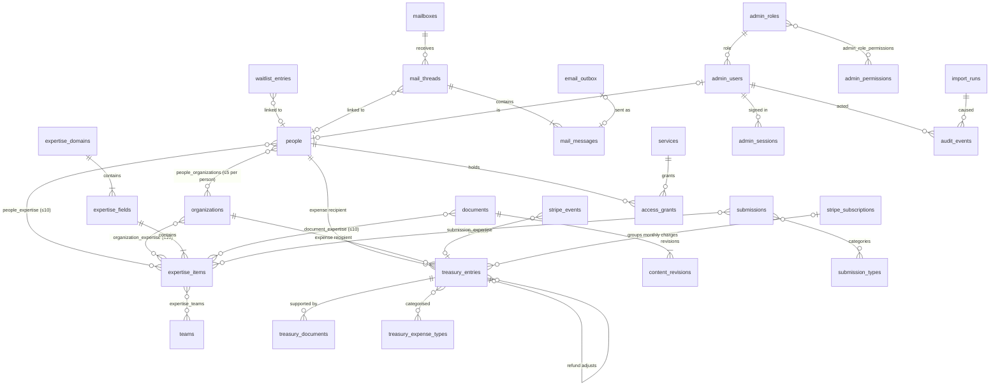
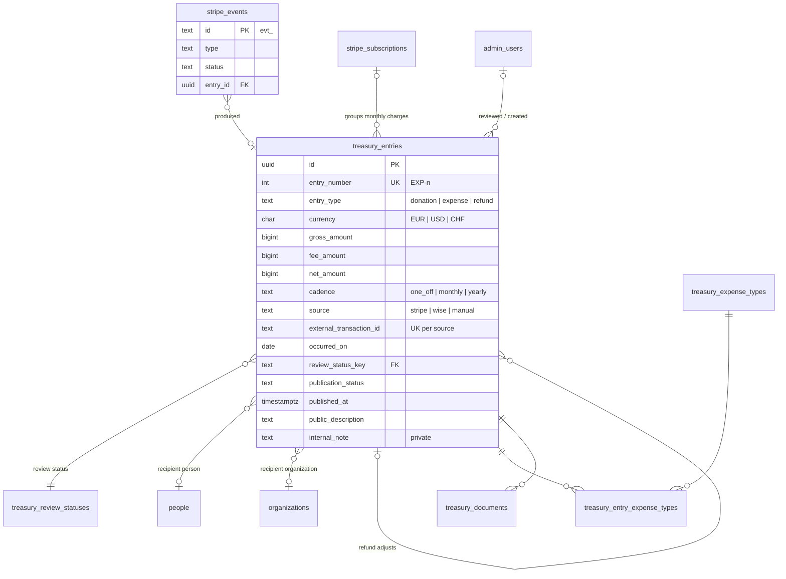
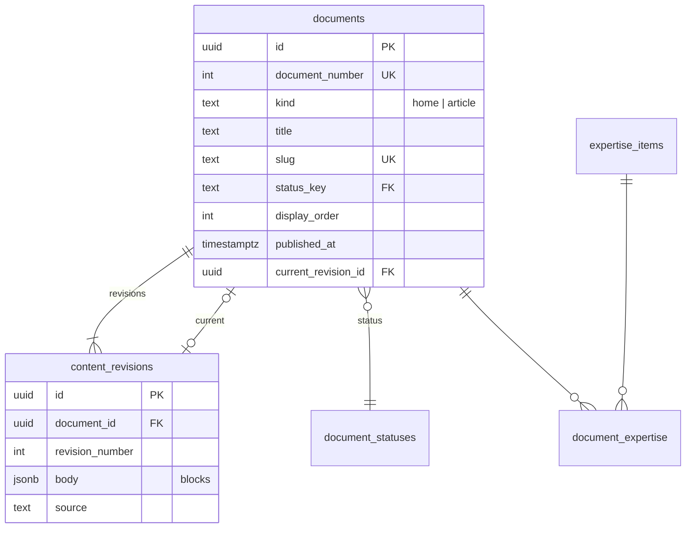
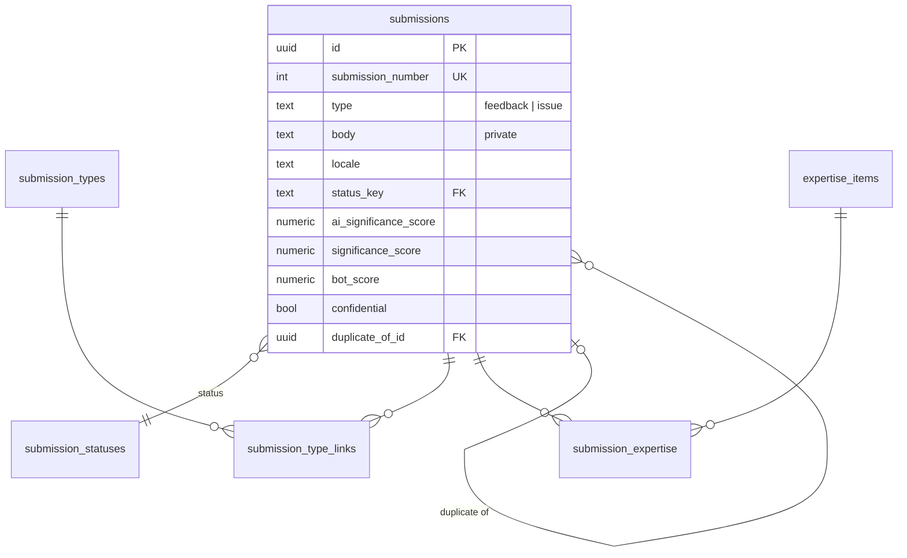
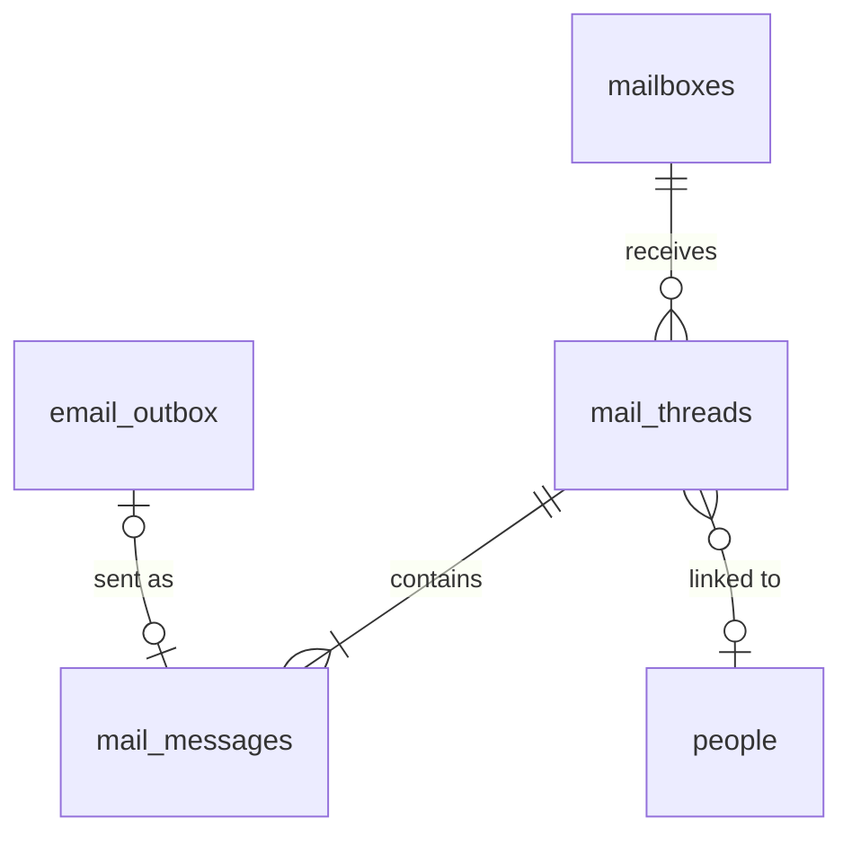
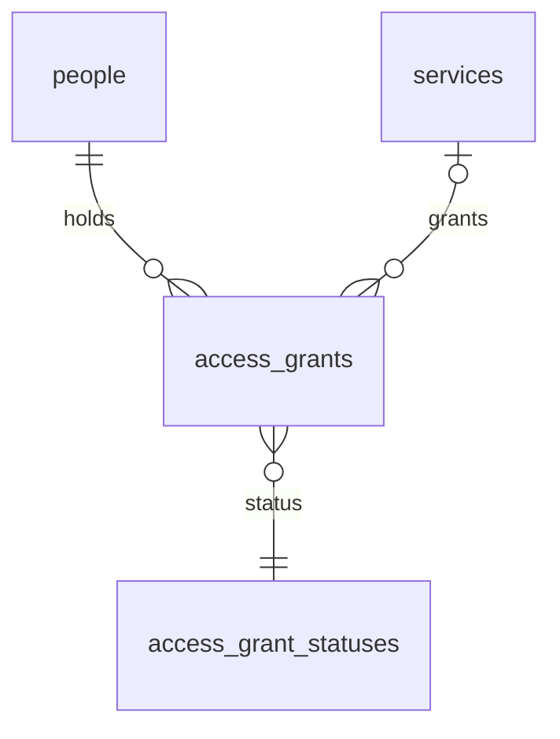

# Data model — v0.1, ready for v1.0

Status: **decided and built** for the Directory and the Taxonomy
(migrations 0000–0005); **proposed** (2026-10-15) for every other module.
Architecture: [overview.md](./overview.md). Build order:
[roadmap.md](./roadmap.md). Client decisions referenced as **Qn** are
listed in [roadmap.md §5](./roadmap.md#5-open-questions-for-the-client);
nothing here assumes their answer — where one is needed the safest form is
specified and marked.

This document maps the client's Notion **"0.1 native"** databases (the
legacy "Community" database is ignored) onto the native PostgreSQL schema
of the NestJS API, defines how imports behave, and fixes the migration
order. Notion inspected through the API on 2026-10-15 (read-only):

| Notion database | Rows | Real / demo | Native module |
|---|---|---|---|
| People | 20 | all demo | Directory (built) |
| Organizations | 20 | all demo | Directory (built) |
| Domains / Fields / Expertise | 14 / 120 / 1105 | all real, imported | Taxonomy (built) |
| Treasury | 40 | all demo (`DEMO-` ids, "demo" notes) | Treasury |
| Feedbacks and issues (1) | 10 | all demo | Feedback and issues |
| Services | 14 | all demo | Services |
| Access grants | 20 | all demo | Access grants |
| Documentation (1) | 10 | **all real**, published | CMS |
| Home (page) | 15 blocks | real | CMS |

**Section numbers before 2026-10-15** (cited in code comments, to be
updated with the next code change in each file): §2 People → §3.2,
§3 Organizations → §3.3, §4 Taxonomy → §3.4, §5 Notion import rules and
"No demo data" → §13, §6 future modules → §4–§9, §8 migration 0002 →
§14.1, §9 open questions → [roadmap.md §5](./roadmap.md#5-open-questions-for-the-client)
(old Q1 → Q1, Q3 → Q33, Q4 → Q28, Q5 → Q5, Q6 → Q6, Q7 → Q7, Q8 → Q10).

## 1. Conventions

Kept from the built schema, for every table below:

- `uuid` primary keys (`gen_random_uuid()`), except lookup tables (a text
  `key`) and the append-only audit log (`bigint` identity).
- `created_at`, `updated_at` as `timestamptz not null default now()`.
- snake_case; explicit `ON DELETE` on every foreign key (`restrict` unless
  the child is meaningless without its parent).
- **Vocabularies are lookup tables** (`key`, `label`, `sort_order`,
  `created_at`) — options can be added or relabelled without a destructive
  migration — except for small value sets the *code* branches on (entry
  type, source, direction), which are `text` + CHECK.
- **Money** is integer **minor units** (`bigint`, cents), never floats;
  every amount has its `currency`; totals are per currency; no conversion is
  stored unless a provider gives one (Stripe settlement, §4).
- **Record numbers** shown as `PER-n`, `ORG-n`, `EXP-n`, `SVC-n`, `ACC-n`,
  `#n` are `integer generated by default as identity`, unique, > 0,
  **preserved from Notion** on import; the prefix is display formatting.
- **Import key**: `notion_page_id uuid`, unique when present.
- Invariants are **CHECK constraints** (or constraint triggers for rules
  across rows), never only UI logic.
- Personal data columns are marked *private*: served only by the
  authenticated admin API, never in a public endpoint, export or log.
- **Record origin** (decided 2026-10-15, overview §2.1): every importable
  table has `managed_by text not null default 'native'`, CHECK in
  (`notion`, `native`), and CHECK `managed_by = 'native' or notion_page_id
  is not null`. Importers insert and update **only** `notion` rows (and
  links between them); the API refuses writes to a `notion` row's synced
  fields (409 `managed_in_notion`). Tables: `people`, `organizations`,
  `expertise_domains`, `expertise_fields`, `expertise_items`,
  `treasury_entries`, `documents`, `submissions`, `services`,
  `access_grants`. Existing rows that came from an import (non-null
  `notion_page_id`) get `notion` when the column is added; all others
  `native`. Never importable (always native): `stripe_events`,
  `stripe_subscriptions`, `waitlist_entries`, mail tables, `audit_events`,
  `settings`.

### 1.1 `settings` (module modes, feature flags)

| Column | Type | Rules |
|---|---|---|
| `key` | text PK | `^[a-z][a-z0-9_]*(\.[a-z0-9_]+)+$`, e.g. `module.directory.mode`, `donations.monthly` |
| `value` | jsonb | Validated in code against the key's declared type |
| `updated_by_admin_id` | uuid null → admin_users `set null` | |
| `updated_at` | timestamptz | |

Keys are declared in code with a type and an **environment default**; a
missing row means "use the default", so a fresh database needs no seed.
Every change writes an audit event. Declared keys in v0.1:

| Key | Type | Default (env) | Meaning |
|---|---|---|---|
| `module.<key>.mode` | `notion` \| `native` | `notion` for Notion-backed modules | Overview §2.1 |
| `imports.<key>.schedule` | interval or `off` | `off` | Scheduled import per module |
| `donations.enabled` | boolean | `DONATIONS_ENABLED` = false | Donations open: until then `/donate` says "Donations open soon" and Checkout is refused (403 `donations_closed`), except through the private preview link `?preview=<DONATIONS_PREVIEW_TOKEN>` |
| `donations.monthly` | boolean | `DONATIONS_MONTHLY` = false | Monthly donations (Stripe subscriptions) |
| `donations.extra_methods` | boolean | `DONATIONS_EXTRA_METHODS` = false | PayPal and SEPA rows (Q19) |
| `donations.paypal_monthly` | boolean | `DONATIONS_PAYPAL_MONTHLY` = false | PayPal also on Monthly (Stripe subscriptions with PayPal; decision 17, 2026-10-19). Needs `donations.monthly` and `donations.extra_methods` |
| `donations.checkout` | `embedded` | `hosted` | `DONATIONS_CHECKOUT` = embedded | One-off card donations: Stripe card fields on the donate page, no email, a reference on the thank-you page (embedded; needs `STRIPE_PUBLISHABLE_KEY`, otherwise hosted) or Stripe Checkout (hosted). Monthly is always hosted (decision 17) |
| `donations.default_currency` | `EUR` \| `USD` \| `CHF` | `DONATIONS_DEFAULT_CURRENCY` = USD | Donate page's initial currency |
| `treasury.stats_currency` | `EUR` | `USD` | `CHF` | `TREASURY_STATS_CURRENCY` = USD | Currency of the public Treasury stats (decision 2, 2026-10-19) |
| `treasury.public_toolbar` | boolean | `TREASURY_PUBLIC_TOOLBAR` = false | Public Treasury search, sort, filter and currency switch; off: the history lists every currency, latest first (decision 2) |
| `treasury.wise_connected` | boolean | `TREASURY_WISE_CONNECTED` = false | Shows Balance and Sustainability (hidden until Wise) |
| `treasury.public_recipient_names` | boolean | `TREASURY_PUBLIC_RECIPIENT_NAMES` = false | Public pages show an expense's recipient name; off: only the public description (pending client answer) |
| `treasury.publish_unqualified` | boolean | `TREASURY_PUBLISH_UNQUALIFIED` = false | Unqualified expenses may be published ("Not qualified yet"); off: only Qualified / Not required entries can be published or are public (Q25, pending) |
| `treasury.donation_appeal` | boolean | `TREASURY_DONATION_APPEAL` = false | The Treasury page's "Cry for donation" banner (set by hand until Wise gives a Sustainability score) |
| `treasury.sample_figures` | object or null | null (no environment variable) | Before Wise: sample Balance (per currency, minor units), Sustainability and their trends, shown with a "sample figures" note. Set and removed by the sample-treasury commands; ignored once Wise is connected |
| `treasury.show_test_donations` | boolean | `TREASURY_SHOW_TEST_DONATIONS` = false | Production before go-live: Stripe test-mode donations on the public Treasury and donate figures, marked Test. Ignored with a live Stripe key |

The table is created by **migration 0006** (module 1, which is the first
to need flags) with the `donations.*` keys declared
(`apps/api/src/settings/settings.registry.ts`); the other keys are declared
with their modules. A stored value that doesn't match its key's type is
ignored (the environment default applies) and logged by key only. Until
module 2 adds the admin page and audit events, rows are changed only by
SQL in a release runbook.

### 1.2 Decisions 2026-10-19

The owner's decisions of 2026-10-19 (list and steps: overview §2.3), as
they land in the data model:

- **Settings:** `donations.paypal_monthly`, `donations.checkout`,
  `treasury.stats_currency`, `treasury.public_toolbar` (Step 2, above);
  `cms.mode` (5b), `ai.enabled`, `history.view_event_window_hours` = 24
  (5), `email.enabled` (7).
- **Lookups:** `contact_channels` seeded with Email, Phone, WhatsApp,
  Signal, Telegram, LinkedIn, X, Matrix, Workana; contract statuses (8).
  Seeded vocabulary only, never demo rows.
- **Columns:** `people.relevance_score` and `people.ai_relevance_score`
  integer 0–10, nullable (check constraint); `archived_at` / `archived_by`
  on every record table (archive instead of delete; permanent delete
  owner-only, logged); `access_grants.person_id` → `people` with an
  optional admin account link, `services.responsible_account_id` →
  `admin_users` (8).
- **Tables:** comments (authors edit or delete their own; versions kept),
  record views (every opening; the feed folds them per account per window),
  field-level privacy as config enforced by the API (5); invitations and
  one-time links valid 72 h, account deactivation instead of delete, the
  last Rootadmin protected (7); `contracts` (CON-n, 8); saved views per
  account, shared by the owner, ordered (9).
- **Donations:** one-off card donations may come from a PaymentIntent
  (`payment_intent.succeeded`, metadata `flow = embedded`) instead of a
  Checkout session; the ledger row, its idempotency and the refund and
  dispute rules are the same (§4.1, §4.4).

## 2. Overview

Every module's own diagram and columns follow.

## 3. Directory and Taxonomy (built, 0001–0005)

### 3.1 Current tables

| Table | Purpose | Notes |
|---|---|---|
| `people` | People directory | §3.2 |
| `person_states`, `person_sources` | Lookups | States: Sourced, Contacted, In discussion, Collaborating, On hold, Rejected. Sources: AI, Candide, Contribution email, Other. |
| `organizations` | Organizations | §3.3 |
| `people_organizations` | Person ↔ Organization | Composite PK; one link read from both sides. |
| `expertise_domains` → `expertise_fields` → `expertise_items` | Taxonomy | §3.4 |
| `teams`, `expertise_teams` | Six teams, items ↔ teams | Communication, Compliance, Moderation, Operations, Tech, Treasury. |
| `taxonomy_statuses` | Lookup | Active, Proposed, Deprecated. |
| `people_expertise`, `organization_expertise` | Entity ↔ Expertise item | Expertise level only; fields/domains derived by joins. |
| `import_runs` | Every import run (§12) | |
| `admin_users`, `admin_sessions` | Owner sign-in (§10) | |

### 3.2 People — Notion "People" mapping

| Notion property | Column | Rules |
|---|---|---|
| Name | `name text` | 1–200, not unique (duplicates flagged, never merged). |
| *State | `state_key` → `person_states` | Lookup. |
| *Source | `source_key` → `person_sources` | Lookup. |
| *Personal note | `personal_note text` | ≤ 5000, *private*. |
| Organizations | `people_organizations` | **≤ 5 per person** (§3.5). |
| Expertise *(not in Notion any more)* | `people_expertise` | **≤ 10 per person**; links left alone by imports while Notion has no property. |
| Do not contact | `do_not_contact boolean not null default false` | |
| Follow-up date | `next_followup_on date` | Index; overdue = before today (Europe/Zurich). Old `last_followup_at` kept read-only in `last_followup_at_legacy`. |
| Email / Phone / Website / LinkedIn / X / Other contact details | `email`, `phone`, `website`, `linkedin`, `x`, `other_contact` | *private*; email shape check, ≤ 320 / 64 / 2048 / 2048 / 2048 / 500. |
| Wise recipient account ID | `wise_recipient_id text` | ≤ 100, *private*. |
| Person ID (PER-n) | `person_number integer identity` | Unique, > 0. |
| Access grants | — | Read from `access_grants` (§9), not stored here. |
| Expenses | — | Read from `treasury_entries.recipient_person_id` (§4). |
| Created / Updated | `created_at` / `updated_at` | |
| *(import key)* | `notion_page_id uuid` | Unique when present. |

### 3.3 Organizations — Notion "Organizations" mapping

| Notion property | Column | Rules |
|---|---|---|
| *Name | `name text` | 1–200, not unique. |
| *Description | `description text` | ≤ 5000. |
| *Website | `website text` | ≤ 2048. |
| *Email | `email text` | Shape check, ≤ 320, indexed `lower(email)`. |
| *Wise recipient account ID | `wise_recipient_id text` | ≤ 100, *private*. |
| People | `people_organizations` | Each person's ≤ 5 limit applies when linking from here. |
| Expertise | `organization_expertise` | **≤ 10 per organization**. |
| Organization ID (ORG-n) | `org_number integer identity` | |
| Expenses | — | Read from `treasury_entries.recipient_organization_id`. |
| *(import key)* | `notion_page_id uuid` | |

### 3.4 Taxonomy — Notion "Domains", "Fields", "Expertise"

| Notion | Domain | Field | Expertise item | Rules |
|---|---|---|---|---|
| Title | `name` | `name` | `name` | Unique among siblings (case-insensitive). |
| Parent relation | — | `domain_id` | `field_id` | `ON DELETE restrict`. |
| Stable ID | `stable_id` | `stable_id` | `stable_id` | `domain.NN.slug` / `field.NN.NN.slug` / `NN.NN.slug` CHECKs; Notion's auto-link segments are joined on import. |
| Status | `status_key` → `taxonomy_statuses` | same | same | |
| Team (items) | — | — | `expertise_teams` → `teams` | |
| Full path (items) | — | — | — (computed) | Domain > Field > Item, from the joins. |

### 3.5 Relationship limits as database rules (new in 0008)

Today the 10 expertise / 5 organizations limits are enforced by the API
and the importer (contracts, link endpoints, importer cap). Migration 0008
(module 2) adds a **deferrable constraint trigger** per link table so no code path —
present or future, including a manual SQL fix — can exceed them:

| Link table | Owner column | Limit |
|---|---|---|
| `people_expertise` | `person_id` | 10 |
| `organization_expertise` | `organization_id` | 10 |
| `people_organizations` | `person_id` | 5 |
| `document_expertise` (§5) | `document_id` | 10 |

`CREATE CONSTRAINT TRIGGER … AFTER INSERT … DEFERRABLE INITIALLY DEFERRED
FOR EACH ROW` counting the owner's links and raising `check_violation`
(SQLSTATE 23514) with a message naming the limit; deferred so a set
replaced inside one transaction (delete all, insert new) is checked once
at commit. The API maps the error to its existing 400 message.

## 4. Treasury

Donations and expenses in one ledger; Stripe donations written by webhook;
Wise later. Notion "Treasury" (24 properties, 40 demo rows).

### 4.1 `treasury_entries`

| Column | Type | Rules | Notion property |
|---|---|---|---|
| `id` | uuid PK | | |
| `entry_number` | integer identity | Unique, > 0; displayed `EXP-n` (Notion's prefix for every entry) | Transaction ID |
| `notion_page_id` | uuid | Unique when present | *(page id)* |
| `entry_type` | text | `donation`, `expense`, `refund`, `dispute` (CHECK). `dispute` = a Stripe dispute adjustment of a donation (module 1, decided 2026-10-15) | Entry type (Donation / Expense) |
| `name` | text | 1–200; internal label ("Anonymous donation" for Stripe) | *Name |
| `currency` | char(3) | `EUR`, `USD`, `CHF` (CHECK) | Currency |
| `gross_amount` | bigint | Minor units. **donation > 0; expense < 0; refund < 0** (CHECK). Donate form: 1 … 10,000 in the chosen currency (API validation, decided) | — (Notion has net only: imported as gross = net, decided) |
| `fee_amount` | bigint null | ≥ 0 (CHECK); null until known | — |
| `net_amount` | bigint null | `fee null ⇔ net null`; else `net = gross − fee` (CHECK, Q28) | Net amount |
| `settlement_currency` | char(3) null | Stripe settlement when it differs (Q18) | — |
| `settlement_gross_amount`, `settlement_fee_amount`, `settlement_net_amount` | bigint null | All four settlement columns and `exchange_rate` set together or none (CHECK, each tested `is not null` explicitly — a CHECK that evaluates to NULL passes); settlement currency ≠ `currency`; fee ≥ 0; net = gross − fee | — |
| `exchange_rate` | numeric(18,8) null | Provider's rate, only with settlement columns | — |
| `cadence` | text | `one_off`, `monthly`, `yearly` (CHECK), default `one_off`. **No yearly donations** (decided): CHECK `entry_type <> 'donation' or cadence <> 'yearly'`; yearly stays for Notion expenses (e.g. annual subscriptions) | *Cadence |
| `source` | text | `stripe`, `wise`, `manual` (CHECK) | Source |
| `livemode` | boolean | Default true. Stripe rows: the event's mode (test `false` / live `true`); every other source is real money, so `source = 'stripe' or livemode` (CHECK). Public figures show only the public mode (below) | — |
| `external_transaction_id` | text null | Unique per `source` when present (Stripe charge `ch_…` / refund `re_…`; Wise transfer id) | External transaction ID; *Wise transaction number for Wise rows |
| `recurrence_id` | text null → `stripe_subscriptions` | Subscription id grouping a monthly donation's charges (no personal data); only with the `donations.monthly` flag | — |
| `managed_by` | text | `notion` (Notion expenses) or `native` (Stripe donations and refunds, admin-made entries); §1 | — |
| `source_account_id` | text null | *private* | Source account ID |
| `occurred_on` | date | Booking date | Transaction date |
| `occurred_at` | timestamptz null | Exact time when the source gives one (Stripe, Wise) | — |
| `recipient_person_id` | uuid null → people `restrict` | | *Recipient person |
| `recipient_organization_id` | uuid null → organizations `restrict` | | *Recipient organization |
| `adjusts_entry_id` | uuid null → treasury_entries `restrict` | Required for `refund` (CHECK) | — |
| `review_status_key` | text → `treasury_review_statuses` | Default `unqualified` | Review status |
| `reviewed_at` | timestamptz null | | Reviewed on |
| `reviewed_by_admin_id` | uuid null → admin_users `set null` | Notion's "Reviewed by" (a person, empty in all rows) is reported, not mapped | Reviewed by |
| `publication_status` | text | `unpublished`, `published` (CHECK) | Publication status |
| `published_at` | timestamptz null | Set ⇔ published (CHECK) | Published on |
| `public_description` | text null | ≤ 2000 | Public description |
| `internal_note` | text null | ≤ 5000, *private* | Internal note |
| `imported_at` | timestamptz null | | Imported at |
| `created_by_admin_id` | uuid null → admin_users `set null` | Null for webhook/import rows | — |
| `created_at`, `updated_at` | timestamptz | | Created / Updated |

**Business rules (CHECK unless noted):**

1. Signs: `donation` gross > 0; `expense` gross < 0; `refund` gross < 0;
   `dispute` gross ≠ 0 (negative when Stripe withdraws the funds, positive
   when it reinstates them); `refund` and `dispute` ⇔ `adjusts_entry_id`
   not null; `fee ≥ 0` (on disputes it may be negative: Stripe can give the
   dispute fee back when a dispute is won; same for the settlement fee);
   `net = gross − fee`.
2. Recipient: donations, refunds and disputes have **no recipient** (both null);
   an expense has **at most one** (`not (person and organization)`); a
   **qualified or not-required expense has exactly one**. (Donor identity
   is never stored — v1.0 extension in overview §7.)
3. Publication: `published_at is not null ⇔ publication_status =
   'published'`. A published entry whose review status is `qualified` or
   `not_required` must have a non-empty `public_description`. Whether
   unqualified expenses may be published at all — Figma lists them as "Not
   qualified yet" — is **Q25**; the recommended rule (publish amount and
   date, the description only once qualified) is what this CHECK allows.
   If the client chooses "qualified only", one more CHECK is added.
4. Uniqueness: `(source, external_transaction_id)` unique where not null —
   Stripe and Wise syncs are idempotent.
5. Adjustments: a trigger checks that `adjusts_entry_id` points to a
   `donation` of the same currency **and Stripe mode**; that refunds and
   disputes together never take more than the donation; and that a
   dispute never gives back more than it withdrew.

Also enforced by the same trigger: a donation that has adjustments keeps
its type, currency, amount and mode; an expense with expense types can't change
type. A second trigger allows expense types on expenses only.

Indexes: unique `entry_number`; unique `notion_page_id` (partial); unique
`(source, external_transaction_id)` (partial); `occurred_on desc` partial
on published; `entry_type`; `currency`; `recipient_person_id`;
`recipient_organization_id`; `adjusts_entry_id`; `recurrence_id`;
`created_at` partial on Stripe entries still awaiting their fee (the late-fee
fill-in job, §4.4); and `created_at` partial on test-mode rows (the purge).

Public reads go through a view **`treasury_public_entries`** (id, number,
type, currency, gross, net, cadence, occurred_on/at, published_at,
review_status_key, recurrence_id, adjusts_entry_id, source, livemode, and
the public description only when `qualified` or `not_required`) — the
public API cannot select a private column by mistake.

**Sample entries (`sample`, migration 0008):** before go-live, production
carries sample expenses (manual source only, CHECK), published and "Not
required", with one shared sample recipient organization; the public API
marks them `test` ("Test" on the page) and the admin shows Mode "Sample".
`npm run api:seed-sample-treasury -- --confirm` adds them with the sample
figures (refused with a live Stripe key or when samples exist);
`npm run api:purge-sample-treasury -- --confirm` removes every sample
entry, the sample recipient and the figures in one transaction (refused
while a sample has documents). Both are dry runs by default.

**Test vs live:** the public API shows every non-Stripe row and the Stripe
rows of the public modes: in production (`NODE_ENV=production`) live rows,
plus test-mode (sandbox) rows while `treasury.show_test_donations` is on
and the configured key is a test key (before go-live), each marked `test`
("Test" on the page); with a live key, live rows only, whatever the
setting. Elsewhere the configured key's mode, unmarked. The same rule
applies to the donate page's figures and to Monthly donors
(`stripe_subscriptions.livemode`). The admin list shows, per entry,
whether visitors see it now (`publicNow`: "Published, not public"
otherwise).
Test-mode rows are removed with `npm run api:purge-test-donations`
(dry run by default; `--confirm --backup <file>` deletes them in one
transaction, only with a backup from the last 24 hours). Expense types are public facts of a published expense
and are read from `treasury_entry_expense_types` by entry id (module 1b).

**Public Treasury API (module 1b):** `GET /api/treasury/overview?currency=`
(Med. donation, Expenses total and count per currency, the banner flag,
the last visible change, and the filter values that have data — currencies,
expense types, first and last date; Balance and Sustainability are `null`
until Wise, or the sample figures (`sampleFigures`); `trends`: each stat's
percent change from 30 days earlier, null without a base), `GET /api/treasury/entries?type&currency&from&to&expenseType&q&sort&page&pageSize`
(type `expense` or `donation` — donations with their refunds and disputes;
`q` searches public text only: the description, expense type labels, the
entry number; sorts by date or absolute amount) and `GET /api/treasury/entries/:number`.
On top of the view and the mode rule: while `treasury.publish_unqualified`
is off only Qualified / Not required entries are public, even one published
while it was on; a recipient's name is selected only while
`treasury.public_recipient_names` is on. Every response is cached by the
web server under the `treasury` tag (on-demand revalidation after each
change — Stripe webhooks, admin publication and review, applied Treasury
imports — and a 5-minute fallback).

**Admin rules (module 1b, `/api/admin/treasury`):** Notion-managed entries
are read-only (409 `managed_in_notion`) — edit in Notion, then import;
native Stripe entries change only their internal note and publication;
publishing needs a public mode (a test-mode entry in production only while
`treasury.show_test_donations` is on before go-live),
a public description once reviewed, and `treasury.publish_unqualified` for
an unqualified one; review statuses apply to native expenses only, and
Qualified / Not required are offered only with a recipient. The record's
`permissions` block carries these rules (with the reason when refused) so
the page never offers a refused action. Owner role only until `treasury.*`
permissions exist (Q8). No create or delete endpoint: expenses come from
Notion, donations from Stripe.

Native Stripe entries (module 1): `managed_by = 'native'`, `source =
'stripe'`, review `not_required`, published at once; name / public
description "Anonymous donation", "Donation refund" / "Refunded donation",
and for disputes "Payment disputed" (withdrawn) and "Dispute won"
(reinstated). The donate page's figures come from the view through
`GET /api/treasury/summary?currency=`, per currency, never converted: each
donation counts at what remains after its refunds and dispute adjustments;
the **total** is the sum of what remains; the **count** and the **median**
leave out donations with nothing left (fully refunded, or disputed and
lost) and use the net remaining amount of partly refunded ones (decided);
Monthly donors = active subscriptions of the public mode.

### 4.2 Lookups and links

| Table | Columns | Seeded |
|---|---|---|
| `treasury_review_statuses` | key, label, sort_order | `unqualified` Unqualified (public tag "Not qualified yet"), `pending_documents` Pending documents, `qualified` Qualified, `not_required` Not required |
| `treasury_expense_types` | key, label, sort_order | Notion "*Expense type": Legal and compliance, Accounting and administration, Banking and payment processing, Software and subscriptions, Hosting and infrastructure, Development and engineering, Design and product, Research and consulting, Communication and content, General operations (decided: Notion's 10 types) |
| `treasury_entry_expense_types` | entry_id → entries `cascade`, type_key → types `restrict`, PK both | Only on expenses (trigger) |

### 4.3 `treasury_documents` (supporting documents)

| Column | Type | Rules |
|---|---|---|
| `id` | uuid PK | |
| `entry_id` | uuid → treasury_entries `restrict` | |
| `file_name` | text | 1–255, as uploaded (shown only to admins) |
| `content_type` | text | `application/pdf`, `image/png`, `image/jpeg` (CHECK) |
| `size_bytes` | integer | 1 … 20 MB (CHECK, Q5) |
| `sha256` | char(64) | Hex; unique per entry |
| `storage_key` | text | Opaque key for the storage adapter (`sha256/<2>/<sha256>`): content-addressed, so the same file attached to two entries is stored once; indexed, not unique. The bytes are removed when the last document using them is deleted |
| `uploaded_by_admin_id` | uuid → admin_users `set null` | |
| `uploaded_at` | timestamptz | |

*Private* entirely: listed, uploaded, downloaded and deleted only by the
owner in the admin (`/api/admin/treasury/:id/documents`,
`/api/admin/treasury/documents/:id`, always `Content-Disposition:
attachment`, `nosniff`, `no-store`); never in a public response. The type is
judged from the file's bytes (PDF, PNG or JPEG), never its name. Files live
behind the file-storage adapter (`FILE_STORAGE_DIR`, production
`/var/lib/global-experiment/files`: outside the web root, in the backups);
an S3-compatible adapter can replace it without a schema change (Q5).
Deleting a document becomes an audited action with module 2; whether files
may ever be deleted (accounting retention) is Q5/Q11.

### 4.4 `stripe_events` (exactly-once webhook processing)

| Column | Type | Rules |
|---|---|---|
| `id` | text PK | Stripe event id `evt_…` |
| `type` | text | e.g. `checkout.session.completed`, `invoice.paid`, `charge.refunded` |
| `livemode` | boolean | Must match the configured mode, else ignored |
| `object_id` | text | Id of the event's object (no payload stored: it can contain donor personal data) |
| `stripe_created_at` | timestamptz | |
| `received_at` | timestamptz | |
| `status` | text | `received`, `processed`, `ignored`, `failed` (CHECK) |
| `attempts` | integer | ≥ 0 |
| `last_error` | text null | No personal data |
| `processed_at` | timestamptz null | |
| `entry_id` | uuid null → treasury_entries `set null` | The entry it produced, if any |

Processing: insert the event row (`on conflict do nothing`); if already
`processed` or `ignored`, answer 200 "duplicate"; otherwise read the
current objects from Stripe (never the payload), then **one transaction**
locks the event row (`for update`, so concurrent deliveries wait), writes
the ledger and marks it `processed` (or `ignored` with a reason: another
mode, not a donation, payment still pending, unhandled type). Combined with
the unique `(source, external_transaction_id)`, a redelivered or
out-of-order event can never create a second entry. When Stripe isn't
ready (charge not settled, refund before its donation is known) or a
currency isn't EUR/USD/CHF, the delivery answers 409 and the event is
`failed` with a short code in `last_error` (`retry:charge_not_ready`,
`retry:donation_not_recorded`, `retry:unsupported_currency`) — Stripe
retries it. Fees Stripe reports later are filled in, once, by a job every
`STRIPE_FEE_RECONCILE_MINUTES` (default 15); known amounts are never
overwritten.

Events handled: `checkout.session.completed` (one-off, paid),
`checkout.session.async_payment_succeeded` (delayed methods),
`payment_intent.succeeded` (one-off card paid on the donate page, only
PaymentIntents with `kind = donation` and `flow = embedded`; 2026-10-19),
`invoice.paid` (each monthly charge, first included — monthly flag only),
`charge.refunded` (one **negative refund entry** per Stripe refund, linked
to the donation — decided), and `customer.subscription.created / updated /
deleted` (keeps `stripe_subscriptions` current), and
`charge.dispute.funds_withdrawn` / `charge.dispute.funds_reinstated` (one
**dispute adjustment** per dispute balance transaction `txn_…`, negative
then positive, linked to the donation; gross in the donation's currency,
Stripe's figures — dispute fee included — as fee or settlement columns).
Every entry carries the event's `livemode`. Every new or changed entry
triggers the public pages' on-demand revalidation (overview §3.7).

### 4.4b `stripe_subscriptions` (monthly donations, behind `donations.monthly`)

| Column | Type | Rules |
|---|---|---|
| `id` | text PK | Stripe subscription id `sub_…` |
| `livemode` | boolean | Test or live mode (from the event) |
| `status` | text | Stripe's status (`active`, `past_due`, `canceled`, …) |
| `currency` | char(3) | EUR, USD, CHF |
| `amount` | bigint | Monthly amount, minor units, > 0 |
| `started_at` | timestamptz | |
| `canceled_at` | timestamptz null | |
| `created_at`, `updated_at` | timestamptz | |

No customer id, email or name — only what the public "**Monthly donors**"
stat needs (count of `active` subscriptions, decided) and what groups a
subscription's charges. Donors manage their donation through Stripe's
customer-portal login link (Stripe emails them), so nothing personal is
stored. The "Donors" stat is **hidden** (anonymous donors only, decided).

### 4.5 Notion "Treasury" → native

Every property maps in §4.1 except: *Expense type → `treasury_entry_expense_types`;
Reviewed by → reported only (it relates to People, the native reviewer is
an admin); *Wise transaction number → `external_transaction_id` for
`source = wise` (empty in all rows). Notion amounts are **whole currency
units** (decided): Net amount × 100 → minor units, imported as **gross =
net, fee = 0**, and each such row is **flagged** in the run report
(`fee_unknown`). Review status empty → `unqualified`. Imported rows are
`managed_by = notion` (read-only in the admin for synced fields). The 40
rows today are demo (`DEMO-` ids, "demo" notes): a dry run skips and lists
all 40.

## 5. CMS (Home and Documentation)

Notion "Documentation (1)" (10 real articles, all Published) and the Home
page (one heading_4 tagline, a heading_2 and five heading_3 sections with
paragraphs). Figma admin p5–p9: Home editor and document editor with the
same toolbar (undo, redo, H1, Text, bulleted list, numbered list, link),
right rail (Last publish, Created, Number, Discard changes, Duplicate as a
draft, Submit changes) and History.

### 5.1 `documents`

| Column | Type | Rules | Notion |
|---|---|---|---|
| `id` | uuid PK | | |
| `document_number` | integer identity | "Number 81" in Figma | — |
| `kind` | text | `home`, `article` (CHECK); exactly one `home` (partial unique index). More kinds (Information notes, Constitution) are rows of the same table later (Q30) | — |
| `notion_page_id` | uuid null | Unique | page id / Home page id |
| `title` | text | 1–200 | Name |
| `slug` | text null | Articles: required, `^[a-z0-9]+(-[a-z0-9]+)*$`, unique among articles; Home: null (CHECK) | Slug |
| `status_key` | text → `document_statuses` | | Status |
| `display_order` | integer null | ≥ 0; articles only | Display order |
| `published_at` | timestamptz null | Set when first published | Published at |
| `current_revision_id` | uuid null → content_revisions `restrict` | The revision the public site shows | — |
| `created_by_admin_id`, `updated_by_admin_id` | uuid null → admin_users | | |
| `created_at`, `updated_at` | timestamptz | "Created" in the right rail | |

Rule: `status = published ⇒ current_revision_id is not null and
published_at is not null` (CHECK).

`document_statuses` lookup: `draft` Draft, `published` Published,
`unpublished` Unpublished, `archived` Archived (Figma pills = Notion options).

### 5.2 `content_revisions`

| Column | Type | Rules |
|---|---|---|
| `id` | uuid PK | |
| `document_id` | uuid → documents `cascade` | |
| `revision_number` | integer | Unique per document, from 1 |
| `title` | text | Snapshot of the title |
| `body` | jsonb | Block array (below); `jsonb_typeof(body) = 'array'` (CHECK); validated by the API |
| `source` | text | `admin`, `notion_import` (CHECK) |
| `created_by_admin_id` | uuid null → admin_users | |
| `created_at` | timestamptz | "Last publish" when it is the current revision |

Each "Submit changes" writes a new revision (never edits one); "Discard
changes" drops the unsaved draft in the browser; "Duplicate as a draft"
creates a new document (status draft) with a copy of the current revision.
The public article **history** page lists the revisions that were current
while the document was published.

**Block model** (the editor's toolbar, and what the Notion importer
already produces): `heading` (level 1–3), `paragraph`, `bulleted_list`,
`numbered_list` (items), each with rich text runs `{ text, bold, italic,
link }`. Links are `https:`, `mailto:` or internal paths only. No raw HTML
is stored.

### 5.3 `document_expertise`

`document_id` → documents `cascade`, `expertise_id` → expertise_items
`restrict`, PK both; **≤ 10 per document** (Figma "Documents can have up to
10 expertise", §3.5). Notion's Documentation "Expertise" is a separate
38-label list, not the taxonomy (Q29): the importer maps labels to taxonomy
items by exact name and reports the rest.

## 6. Feedback and issues

Notion "Feedbacks and issues (1)" (19 properties, 10 demo rows) and the
public composers (one free text + several categories of the chosen kind).

### 6.1 `submissions`

| Column | Type | Rules | Notion |
|---|---|---|---|
| `id` | uuid PK | | |
| `submission_number` | integer identity | Displayed `#n` | Submission ID |
| `notion_page_id` | uuid null | Unique | |
| `type` | text | `feedback`, `issue` (CHECK) | Type |
| `title` | text null | ≤ 200; generated from the text or by an admin | Title |
| `body` | text | 1–20 000 (the composer's limit) | Submission text |
| `locale` | text null | BCP 47 | Locale |
| `translation` | text null | Translation into English | Translation |
| `source_page` | text null | Same-origin path (the composer sanitises it) | Source page |
| `external_submission_id` | text null | Unique | External submission ID |
| `status_key` | text → `submission_statuses` | Default `opened` | Status |
| `decision_rationale` | text null | ≤ 5000, *private* | Decision rationale |
| `ai_note` | text null | AI output, *private* | AI note |
| `ai_significance_score` | numeric(4,2) null | Range Q7 (CHECK added once known) | AI significance score |
| `significance_score` | numeric(4,2) null | Human value, range Q7 | Significance score |
| `bot_score` | numeric(4,2) null | Range Q7 | Bot score |
| `ai_model`, `ai_prompt_version` | text null | Provenance of AI fields | — |
| `ai_assessed_at` | timestamptz null | | — |
| `confidential` | boolean not null default false | True for "Security vulnerability" (set on insert) | — |
| `public_summary` | text null | Only if not confidential (CHECK, Q31) | — |
| `duplicate_of_id` | uuid null → submissions `set null` | ≠ id (CHECK) | — |
| `submitted_at` | timestamptz | | Submitted at |
| `created_at`, `updated_at` | timestamptz | | Last edited at |

`submission_statuses` lookup: `opened` Opened (Figma case state; Notion's
empty), `roadmap_item` Roadmap item, `discarded` Discarded, `archived`
Archived (Notion options; Q6).

### 6.2 Categories and expertise

- `submission_types(key, kind, label, description, sort_order)`, unique
  `(key, kind)`: feedback — Feature request, Enhancement, UX friction,
  Content suggestion, Comparison, Praise; issue — Functional bug, Visual
  bug, Crash, Performance, Data loss, Security vulnerability,
  Accessibility, Broken link, Compatibility (the composer's lists = Notion's
  "Feedback type" / "Issue type").
- `submission_type_links(submission_id, submission_type, type_key)` with
  composite foreign keys `(submission_id, submission_type) → submissions(id,
  type)` and `(type_key, submission_type) → submission_types(key, kind)` —
  the database guarantees a feedback only gets feedback categories.
  (Notion stores one; the composer allows several.)
- `submission_expertise(submission_id, expertise_id)` — Notion's
  "Expertise" labels mapped to taxonomy items by name (same 38-label list
  as Documentation, Q29).

## 7. Waitlist

No Notion database; the public form collects an email only.

| Column (`waitlist_entries`) | Type | Rules |
|---|---|---|
| `id` | uuid PK | |
| `email` | text | Shape check, ≤ 320, **unique on `lower(email)`**, *private* |
| `status` | text | `pending`, `confirmed`, `unsubscribed` (CHECK) |
| `confirmation_token_hash` | char(64) null | SHA-256 of the emailed token (double opt-in, Q17) |
| `confirmed_at`, `unsubscribed_at` | timestamptz null | Match the status (CHECK) |
| `locale` | text null | |
| `source_page` | text null | |
| `consent_version` | text | Version of the text the person agreed to |
| `person_id` | uuid null → people `set null` | Linked by an admin (or automatically, Q17) |
| `created_at`, `updated_at` | timestamptz | |

A second sign-up with the same email re-sends the confirmation instead of
failing (no enumeration of who is on the list).

## 8. Messages and Emails

Stalwart mailboxes `contribute@`, `waitlist@`, `donations@` (inbound) and
outbound mail through one outbox.

| Table | Columns | Rules |
|---|---|---|
| `mailboxes` | `key` PK (`contribute`, `waitlist`, `donations`), `address` unique, `label` | Seeded |
| `mail_threads` | `id`, `mailbox_key` → mailboxes, `subject`, `status` (`new`, `open`, `done`, `spam`), `person_id` → people `set null`, `last_message_at` | *private* |
| `mail_messages` | `id`, `thread_id` → threads `cascade`, `direction` (`inbound`, `outbound`), `provider_message_id` unique (RFC Message-ID), `from_address`, `to_addresses text[]`, `subject`, `body_text`, `has_attachments`, `received_at` / `sent_at`, `outbox_id` → email_outbox | *private*; attachments are not stored in v0.1 |
| `email_outbox` | `id`, `template_key`, `to_address`, `subject`, `body_text`, `body_html`, `status` (`queued`, `sending`, `sent`, `failed`, `cancelled`), `attempts`, `last_error`, `provider_message_id`, `entity_type` + `entity_id` (what it is about), `queued_at`, `sent_at` | *private*; templates live in code (versioned), not in the database |

## 9. Services and access grants

Notion "Services" (7 properties, 14 demo rows) and "Access grants" (14
properties, 20 demo rows).

### 9.1 `services`

| Column | Type | Rules | Notion |
|---|---|---|---|
| `id` | uuid PK | | |
| `service_number` | integer identity | `SVC-n` | Service ID |
| `notion_page_id` | uuid null | Unique | |
| `name` | text | 1–200, unique (case-insensitive) | Name |
| `url` | text null | ≤ 2048, `https://` | URL |
| `description` | text null | ≤ 5000 | Description |
| `status` | text | `active`, `retired` (CHECK) | Status |
| `created_at`, `updated_at` | timestamptz | | Created |

### 9.2 `access_grants`

| Column | Type | Rules | Notion |
|---|---|---|---|
| `id` | uuid PK | | |
| `grant_number` | integer identity | `ACC-n` | Grant ID |
| `notion_page_id` | uuid null | Unique | |
| `name` | text | 1–200 (label) | Name |
| `person_id` | uuid → people `restrict` | Required | Person |
| `service_id` | uuid null → services `restrict` | Empty in 6/20 Notion rows | Service |
| `account_identifier` | text null | Email shape, ≤ 320, *private* | Account identifier |
| `permission_level` | text null | ≤ 100, free text until Q10 (then a lookup) | Permission level |
| `resource_scope` | text null | ≤ 500 | Resource scope |
| `status_key` | text → `access_grant_statuses` | | Status |
| `granted_on`, `revoked_on`, `expires_on` | date null | `revoked_on` set ⇔ revoked; `expires_on ≥ granted_on`; `expired` needs `expires_on` (CHECKs) | Granted on, Revoked on, Expires on |
| `notes` | text null | ≤ 5000, *private* | Notes |
| `created_at`, `updated_at` | timestamptz | | Created, Updated |

`access_grant_statuses` lookup: `planned` Planned, `invited` Invited,
`active` Active, `revoked` Revoked, `expired` Expired. The People list's
"Access grant" column and the record's "Access grant" chips (Figma p12:
GitHub, CloudFlare, Notion, Hetzner, …) are the person's active grants'
service names.

## 10. Accounts and roles

Built: `admin_users` (email, password hash, role, display name, last login)
and `admin_sessions` (hashed tokens, expiry, revocation). Proposed
(migration 0012, Q8):

| Table | Columns | Rules |
|---|---|---|
| `admin_roles` | key, label, sort_order | `owner` (Rootadmin), `admin`, `treasury`, `communication`, `moderation`, `operations`, `tech`, `compliance` |
| `admin_permissions` | key (`module.action`), module, action, label | `action` ∈ read, create, update, publish, delete, import, manage |
| `admin_role_permissions` | role_key, permission_key, PK both | The matrix of overview §3.1 |
| `admin_users` (changes) | `role` → admin_roles (replaces the `in ('owner')` CHECK); `person_id` → people `set null` (an admin who is also in the directory); `deactivated_at` | Partial unique index "one owner" kept |
| `admin_invitations` | id, email, role_key, token_hash, invited_by, expires_at, accepted_at | Only if Q8 adds admins |
| `admin_password_resets` | id, admin_user_id, token_hash, expires_at, used_at | Single use, 1 h |

v1.0 participant accounts are a **separate** `accounts` table (overview §7):
staff access and participation are different concerns with different rules.

## 11. Audit log

| Column (`audit_events`) | Type | Rules |
|---|---|---|
| `id` | bigint identity PK | Append-only |
| `occurred_at` | timestamptz | default now() |
| `actor_type` | text | `admin`, `system`, `import`, `stripe`, `job` (CHECK) |
| `actor_admin_id` | uuid null → admin_users `set null` | Required when actor_type = admin (CHECK) |
| `actor_label` | text | Snapshot shown in History ("Candide · Rootadmin"), so renames don't rewrite history |
| `action` | text | `create`, `update`, `delete`, `publish`, `unpublish`, `link`, `unlink`, `import`, `login`, `logout`, `permission_denied` (CHECK) |
| `entity_type` | text | `person`, `organization`, `treasury_entry`, `document`, `submission`, `access_grant`, … |
| `entity_id` | uuid null | |
| `changes` | jsonb | `{ field: { before, after } }`; links as `{ added: [...], removed: [...] }` |
| `import_run_id` | uuid null → import_runs `set null` | |
| `request_id` | text null | |

Indexes: `(entity_type, entity_id, occurred_at desc)` (the record's History
panel), `(occurred_at desc)` (Monitoring → History), `(actor_admin_id,
occurred_at desc)`. In production the API's database role has `INSERT,
SELECT` only on this table.

## 12. Imports and jobs

- `import_runs` (built): `kind` gains `treasury`, `cms`, `submissions`,
  `services`, `access_grants` (the CHECK is extended in each module's
  migration); counts and issues stay JSON in the run.
- Jobs: **pg-boss** keeps its own schema (`pgboss`), created and migrated by
  the library at startup, not by Drizzle. No job table of ours.

## 13. Notion import rules (all modules)

Unchanged from the built importers, and applied to every new one:

1. **Matching** by `notion_page_id` only (taxonomy also by `stable_id`);
   never by name or email.
2. **Clean-up** of Notion quirks (auto-linked text segments, `http://`
   prefixes); invalid values are left empty and reported, the record kept.
3. **Duplicates** are flagged, never merged.
4. **No AI** in imports.
5. **Completeness, not rejection:** starred (`*`) Notion properties are
   "required for completeness" (Q33); missing values are flagged.
6. **No demo data:** a record is skipped and listed when it has an
   `example.org` email or website, the text "Fictional sample", or an id
   starting with `DEMO-`; `--apply` refuses a run made only of demo
   records. No demo row is ever written to a non-test database.
7. **Idempotent:** a second run with unchanged Notion data changes nothing.
8. **Limits:** caps (10 expertise, 5 organizations) keep the first ones in
   Notion order, flag the record, list what was left out.
9. **Order:** taxonomy → organizations → people → links → services →
   access grants → treasury → documents → submissions; each run is one
   transaction.
10. **Ownership (decided, Q1):** in v0.1 Notion is the editing tool and
    importers run on demand and on a schedule, writing only
    `managed_by = notion` records (§1); `native` records are never
    touched. An importer refuses to run when its module is in `native`
    mode. At the v1.0 cut-over each module switches to `native` (overview
    §2.1) and its importer stops for good.

## 14. Migration plan

Applied in order, each one transaction, each released with a runbook
(backup → migrate → verify). Drizzle generates the DDL from the schema
files; data steps and triggers are added to the generated file by hand.

| # | Name | Module | Contents |
|---|---|---|---|
| 0000–0005 | built | Auth, Directory, Taxonomy, Imports | — |
| **0006** | `treasury_donations` | Treasury (module 1, **24 Oct**) | `settings` (moved here from 0008: module 1 needs its flags); `treasury_review_statuses`, `treasury_expense_types` (seeded); `treasury_entries` (with `managed_by`; view `treasury_public_entries`; integrity trigger); `treasury_entry_expense_types` (expenses-only trigger); `stripe_events`; `stripe_subscriptions` |
| **0007** | `treasury_documents` | Treasury (module 1b) | `treasury_documents`; `import_runs.kind` += treasury |
| **0008** | `platform` | Platform (module 2) | `audit_events`; `managed_by` on `people`, `organizations`, `expertise_domains`, `expertise_fields`, `expertise_items` (backfilled from `notion_page_id`); relationship-limit constraint triggers (§3.5) |
| **0009** | `cms` | CMS | `document_statuses`, `documents`, `content_revisions`, `document_expertise` (+ limit trigger); `import_runs.kind` += cms |
| **0010** | `feedback` | Feedback and issues | `submission_statuses`, `submission_types` (seeded), `submissions`, `submission_type_links`, `submission_expertise` |
| **0011** | `waitlist` | Waitlist | `waitlist_entries` |
| **0012** | `services_access` | Services | `services`, `access_grant_statuses`, `access_grants` |
| **0013** | `admin_roles` | Accounts and roles | `admin_roles`, `admin_permissions`, `admin_role_permissions` (seeded), `admin_users` changes, invitations and password resets (per Q8) |
| **0014** | `mail` | Messages and Emails | `mailboxes` (seeded), `mail_threads`, `mail_messages`, `email_outbox` |

Numbers follow the build order (roadmap §2); if a module moves, its
migration takes the next free number at that time — numbers are never
reused or reordered once released.

### 14.1 History: migrations 0002–0005 (released)

- **0002** directory alignment: `next_followup_on` (old value kept as
  `last_followup_at_legacy`), `wise_recipient_id`, `notion_page_id`,
  `person_number` / `org_number`; organizations `description` (from `note`)
  and `email`; states and sources aligned with Notion (people on removed
  sources listed by NOTICE); taxonomy `stable_id`, `status_key`,
  `notion_page_id`, teams.
- **0003** taxonomy import: `import_runs`, domain Stable ID format, statuses
  Proposed and Deprecated.
- **0004** source "Other".
- **0005** `admin_users.display_name` (nullable, 1–80, trimmed).
