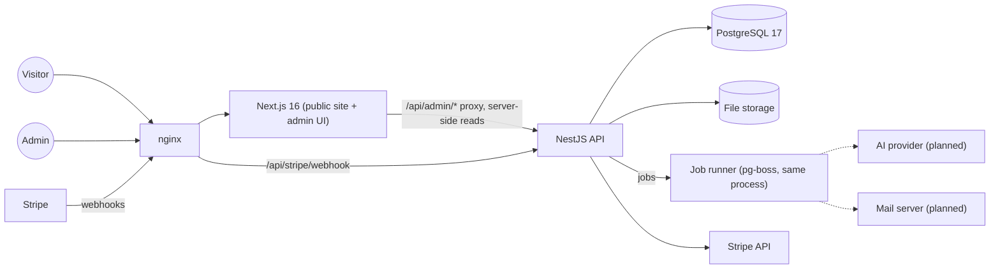

# Global Experiment — Architecture overview (v0.1, v1.0-ready)

Status: **current** (updated 2026-11-19, OPS-104). First written on
2026-10-15; it replaced the M1 overview, which predated the NestJS API and
the admin. Decisions with real trade-offs stay in
[`decisions/`](./decisions/) (ADRs); the database is specified in
[data-model.md](./data-model.md) and the order of work in
[roadmap.md](./roadmap.md). Anything only the client can decide is listed in
[roadmap.md §5](./roadmap.md#5-open-questions-for-the-client) — this
document never assumes an answer to those.

**Sources of truth:**

- **The code:** migrations 0000–0018, the NestJS modules and the admin. The
  code wins over this document; a difference is a documentation bug.
- **Notion "0.1 native"** (read 2026-10-15): Treasury, Feedbacks and
  issues, Services, Access grants, Documentation, People, Organizations,
  Domains, Fields, Expertise and the Home page. The full mapping is in
  data-model.md. Nothing reads Notion at runtime any more (§4).
- **The Figma PDFs** in `docs/design/figma/` (admin desktop, common pages,
  master, profile and account, signup and sign-in). These are local only
  and not committed.

**Client principle:** built the right way and ready to grow into v1.0, with
**no speculative features**. Every module below is something the v0.1 admin
sidebar or public site already shows; v1.0 items are named only as
extension points (§7), never built ahead.

## 1. System at a glance

Dotted lines are planned integrations; everything else is running in
production.

- **One repository, two processes** (ADR [013](./decisions/013-nestjs-native-api.md)):
  the Next.js app renders every page and never touches the database; the
  NestJS API owns PostgreSQL, the business rules and every integration.
  The browser only ever talks to Next.js (same origin); Next.js proxies
  `/api/admin/*` to the API and reads public data from it server-side.
- **Modular monolith** (ADR [001](./decisions/001-modular-monolith.md)):
  one deployable API, one module per business area (§2), modules talk to
  each other only through exported services, never through each other's
  tables.
- **PostgreSQL is the system of record** for everything the admin edits.
  Nothing reads Notion at runtime: Home and Documentation are native since
  2026-11-05 (ADR [020](./decisions/020-native-home-and-documentation.md)),
  and People and Organizations come in by CSV only (ADR 016).

## 2. Module map

Every module lives in `apps/api/src/<module>/` (schema, repository,
service, controllers, contracts, tests) and, for its admin screens, in
`src/modules/admin/<module>/`. "Owns" means only this module writes those
tables.

**Built** (in production):

| Module | Purpose | Owns (tables) | API boundary | Admin pages (menu row) | Public pages | Depends on |
|---|---|---|---|---|---|---|
| **Directory — People** | Contacts the experiment works with: state, source, follow-ups, contact details, expenses paid to them | `people`, `person_states`, `person_sources`, `people_organizations`, `people_expertise`, `contact_channels`, `person_contact_channels` | `/api/admin/people` | People (list, record) | none (never public) | Taxonomy, Organizations, Treasury (expense links), Audit |
| **Directory — Organizations** | Organizations people belong to; expense recipients | `organizations`, `organization_expertise` | `/api/admin/organizations` | Organizations | none | Taxonomy, People, Audit |
| **Taxonomy** | Domain → Field → Expertise vocabulary, and the teams each expertise belongs to | `expertise_domains`, `expertise_fields`, `expertise_items`, `teams`, `expertise_teams`, `taxonomy_statuses` | `/api/admin/expertise/*` | Expertise, Fields, Domains | none yet | Audit |
| **Treasury** | Donations and expenses, review and publication, Stripe donations; Wise later | `treasury_entries`, `treasury_review_statuses`, `treasury_expense_types`, `treasury_entry_expense_types`, `stripe_events`, `stripe_subscriptions` (`treasury_documents` is kept for History only, ADR 021) | `/api/admin/treasury/*`, public `/api/treasury/*`, `/api/donations/*`, `/api/stripe/webhook` | Treasury | `/treasury`, expense and donation detail, `/donate`, `/donate/thank-you` | People, Organizations, Jobs, Audit |
| **CMS** | Home and Documentation content, editor, revisions, versions, images | `cms_documents` (Home is the one of kind `home`), `cms_revisions`, `cms_images` (data-model §5) | `/api/admin/cms/*`, public `/api/cms/*` | Home, Documentation | `/`, `/documentation`, article and its history | Audit, Files |
| **Services and access grants** | Which person and account hold which access to which outside tool | `services`, `access_grants` and their lookups | `/api/admin/services`, `/api/admin/access-grants` | Services, Permissions; People "Permissions" row | none | People, Accounts, Audit |
| **Accounts and roles** | Admin identities, sessions, roles, permissions, invitation links, profiles | `admin_users`, `admin_sessions`, `admin_roles`, `admin_permissions`, `admin_role_permissions`, `admin_invitations`, `admin_tokens`, `admin_user_expertise`, `admin_user_pictures` | `/api/admin/auth/*`, `/api/admin/accounts`, `/api/admin/invitations`, `/api/admin/profile` | Accounts; user card; Profile settings | `/admin/login`, `/admin/join`, `/admin/welcome`, `/admin/reset-password` | Expertise, Files, Audit (no People link, decision 018) |
| **Audit / History** | Who changed what, when; before/after; comments and views | `audit_events`, `record_comments`, `record_views` | written by every module's service; `/api/admin/history/*` | History; History panel on record pages | none | — (used by all) |
| **Imports** | People and Organizations only, from CSV (ADR 016): column and value matching, check, import, report | `import_runs` | `/api/admin/imports/*` | People / Organizations → More options → Import CSV; Imports page; report pages | none | Directory |
| **Settings** | Typed settings and feature flags with environment defaults | `settings` | read by the modules; public donation config | none yet (changed by the owner outside the admin) | Donate page reads public flags | — |

**Planned** (not in the admin menu until they are live, ADR 024; order in
the roadmap):

| Module | Purpose | Tables (data-model) | Admin pages | Public pages |
|---|---|---|---|---|
| **Feedbacks and issues** | Public submissions, automatic qualification, decisions | `submissions`, `submission_types`, `submission_type_links`, `submission_statuses`, `submission_expertise` (§6) | Feedbacks and issues (after Home) | Send feedback, Report issue composers (shells today) |
| **Information notes** | News posts on the public site | CMS documents of a new kind (§5), not a new module | to be designed | Information notes section |
| **Waitlist** | Email sign-ups for the launch | `waitlist_entries` (§7) | Waitlist | `/waitlist` (shell today) |
| **Messages and Emails** | Inbound mail linked to people; outbound delivery log | `mailboxes`, `mail_threads`, `mail_messages`, `email_outbox` (§8) | Messages; Emails | `/contribute` (address only) |
| **Analytics** | Visitor statistics, read from the analytics tool | none | Analytics | none |
| **Technical dashboard** | Health of the stack, jobs, backups, integrations | none | Technical dashboard | none |
| **Teams and governance** | Teams, memberships, moderation tools, reviews, task assignment | roadmap §4 | — | — |

Module notes:

- **Directory and Taxonomy:** People and Organizations are on hold until
  the client decides (roadmap §1). Expense links on a person are
  Treasury recipients, so they also need the Treasury's own permission
  (§3.1).
- **Treasury** is built (modules 1 and 1b, OPS-155). Every business field
  of an expense is edited by a Rootadmin (`treasury.manage`); supporting
  documents left the platform (ADR 021).
- **CMS** is built (Delivery 6, migration 0016, ADR 020): Home and
  Documentation are edited in the admin (ADR 019, Tiptap), every save is a
  revision (draft → published), with versions to view, compare and
  restore. The public site reads the published revisions from the API and
  is revalidated on publish. The Home page and the 10 articles were copied
  from Notion once, on 2026-11-05 (version 1 by "Notion import"); the
  import was then removed.
- **Messages and Emails** (planned) are one integration (Stalwart) with
  two admin views: inbound conversations, and the outbound delivery log.
- **Analytics and the Technical dashboard** (planned) have no tables of
  their own: they show data that lives elsewhere. Building storage for them
  would be speculative.
- **Platform** (settings, module registry, audit) is not a sidebar module:
  it owns `settings` and `audit_events` and serves every other module
  (§2.1, §2.2, §3.2).

### 2.1 Data ownership: Notion in v0.1, native in v1.0

Decided by the client on 2026-10-15 (answers Q1).

**Changed on 2026-10-23 (built 2026-10-30, ADR [016](./decisions/016-imports-csv-only-for-people-and-organizations.md)):**
only People and Organizations take data from outside — a **CSV import**
for admins with write access (the Notion import, kept as a secondary
option at first, was removed on 2026-11-03, OPS-154). Treasury and every
other table are edited **in the admin only**, with no import and no export;
the Taxonomy and Treasury importers and the "Managed in Notion" states
outside People and Organizations were removed.
The text below is the original plan, kept for the record.

- **v0.1:** Notion is the **editing tool** for the Notion-backed modules —
  Directory (People, Organizations), Taxonomy, CMS Documentation and Home,
  Treasury **expenses**, Feedback and issues, Services and access grants.
  Their importers run **on demand** (admin, CLI) and **on a schedule**
  (a job per module, interval in settings).
- **v1.0:** the database and the admin are the **only** source; every
  importer is switched off.
- **Record-level origin.** Every importable table has
  `managed_by text not null` = `notion` | `native` (data-model §1), next to
  `notion_page_id`:
  - `notion` records are created and updated **only by their importer**.
    In the admin their **synced fields are read-only**, shown with a
    "Managed in Notion" badge and a link to the Notion page; fields Notion
    doesn't have (e.g. admin-only links, review metadata the module defines
    as native) stay editable. The API refuses writes to synced fields of a
    `notion` record (409 `managed_in_notion`), whatever the UI shows.
  - `native` records (created in the admin, Stripe donations and refunds,
    website submissions, waitlist entries, messages, audit events) are
    editable and **never touched by an importer** — an importer only reads
    and writes `notion` records and links between them.
- **Module mode.** Each Notion-backed module has a mode `notion` | `native`
  in the `settings` table (`module.<key>.mode`), shown and changed by the
  **owner** in the admin, audited. In `native` mode its importer refuses to
  run (on demand and scheduled) and every one of its records is `native`.

**v1.0 cut-over procedure** (per module, owner only, one at a time):

1. Announce a freeze: nobody edits the module's Notion database.
2. Run a **final import** (dry run, review, apply) and a second dry run
   that must report **0 changes**.
3. Take a database backup (as for a release).
4. **Switch the mode** in the admin: in one transaction the API sets
   `module.<key>.mode = native`, sets `managed_by = 'native'` on all the
   module's records, and moves each record-number identity past the highest
   number Notion used (`setval`) so new records never collide; one audit
   event records the switch.
5. Verify in the admin: the badge is gone and the records are editable;
   the importer button and schedule show "Native — import off".
6. Make the Notion database read-only (Notion permissions), as an archive.

Module specifics:

| Module | Cut-over notes |
|---|---|
| Directory | People and Organizations switch together (shared links); `person_number` / `org_number` identities moved past Notion's highest PER-n / ORG-n. |
| Taxonomy | Switch after Directory (links point to items); new items get Stable IDs in the admin (format checks already in the database). |
| CMS | **Done 2026-11-05, without a mode switch** (ADR 020): one import, then the admin editor; Home and Documentation switched together. |
| Treasury | Expenses switch; donations and refunds are always native (Stripe). Later, Wise sync writes native expense entries directly. |
| Feedback and issues | Notion-made submissions become native; website submissions were native from the start. |
| Services and access grants | Switch together (grants point to services). |

### 2.2 Flexible admin framework

**Built so far:**

- the site's module registry (`src/modules/admin/registry.ts`): the menu's
  rows, routes, required permission and the `active` flag (live modules
  only, ADR 024);
- the shared list engine and record page (`src/modules/admin/table/`,
  `record/`, `ui/`) used by every built module;
- typed settings with environment defaults.

**Not built:** `/api/admin/modules`, an admin Settings page, module modes
and the cut-over action. Notion is no longer a source (§2.1), so the last
two are no longer needed. The plan below is kept for the record.

So that a module or a field is added by configuration, not by a new screen:

- **Module registry.** Each module declares, in one registry entry: its
  menu row (order, icon, label), its routes, the permissions each route
  needs, its mode setting (if Notion-backed) and its feature flags. The
  admin shell builds the menu from the registry plus
  `GET /api/admin/modules` (enabled state, mode, the user's permissions);
  a module that isn't enabled isn't listed (ADR 024).
  Built in Step 3 (2026-10-19) as `src/modules/admin/registry.ts`; since
  2026-11-24 (ADR 024) it holds the menu's order, glyphs, labels, routes
  and an `active` flag, in one flat list as the Figma "Desktop menu", with
  no sections and no "Coming soon" rows. The permissions came with
  accounts and roles (Step 7); `/api/admin/modules` isn't built.
- **Config-driven list pages.** Per module: columns (type — text, select,
  relation, date, number, money, boolean, tags; width; icon; default
  visibility), filters with their operators and option sources, sorts,
  saved views, the toolbar actions (New, Import Notion). The existing list
  engine (search, filter and sort popovers, column menu, freeze, resize,
  reorder, toasts) renders any config.
- **Config-driven record pages.** Per module: property rows (text,
  textarea, pills, pickers with limits and hints, dates, chips, read-only
  values), which fields are synced from Notion (read-only when
  `managed_by = notion`), the right panel (meta rows; Discard / Duplicate /
  Submit actions; custom actions such as Publish) and the History panel.
- **Adding a field** = a migration + an API contract field + one config
  entry. No new page code.
- **Settings and feature flags.** One `settings` table (key → JSON value,
  updated by, updated at; audited). Keys are declared in code with a type
  and an **environment default**, so a fresh install works without rows
  (e.g. `donations.monthly` = `DONATIONS_MONTHLY`, default off;
  `donations.extra_methods` (PayPal, SEPA) default off;
  `donations.default_currency` default USD; `module.<key>.mode`;
  `imports.<key>.schedule`). Public flags are exposed read-only to the
  public site; the owner edits them in the admin.
- **When:** built with module 2 (Audit/History, roadmap), which also
  refactors the existing People, Organizations and Taxonomy pages onto it.
  Until then Treasury uses the existing list/record components, and its
  flags read their environment defaults.

### 2.3 Decisions 2026-10-19

Taken by the owner on 2026-10-19 so the client review can be built without
waiting. Each is a setting, a lookup table or a config entry: changing one
later needs no code change. Built in the step named (plan:
`docs/design/feedback-2026-10-19.md`, local).

| # | Decision | Where it lives | Step |
|---|---|---|---|
| 1 | Home and Documentation get the native CMS now. `cms.mode` = `notion` (default) \| `native`: while `notion`, "Administrate" opens the list, record and editor read-only with the "Managed in Notion" badge and a link to Notion, and the importer keeps the content in sync; `native` is the documented cut-over (§2.1). **Replaced on 2026-11-05 by ADR 020:** no mode, the content is native and edited in the admin. | — | 6 |
| 2 | Public Treasury: the header is back, title and share; the stats use `treasury.stats_currency` (USD); the history lists every currency, latest first. Search, sort, filter and the currency switch stay in the code behind `treasury.public_toolbar` (false). | settings | 2 |
| 3 | Documentation list columns: Title, Status, Display order, Expertise, Last edited by, Updated, Published. | list config | 5b |
| 4 | Accounts page: "Role" column; views All / Active / Invited / Deactivated; "New account" creates an invitation; rows open a view-only profile; no inline editing. **Changed 2026-11-03 (decision 018):** "New invitation link" makes a link with no input, used once within 7 days by whoever creates their own account, with no role until a Rootadmin gives one; views All / Active / No role / Deactivated; Description replaces Note. | list config | 7 |
| 5 | Permissions "Account" = a person of the directory (works for people without an admin login), optionally linked to their admin account. Services "Responsible account" = an admin account. **Changed 2026-11-03 (OPS-148, OPS-130, OPS-138, OPS-151):** a permission's Account is the admin account and People the person; no Responsible account (ownership is the Owner permission); a permission is named "Service / Account / Permission level"; granting is one history event, shown on the account, the service and the person. | schema | 8 |
| 6 | Services and Permissions start empty, fully editable; a Notion importer for Services and Access grants with the usual dry run (demo rows skipped). | importer | 8 |
| 7 | Relevance scores: integers 0–10, nullable, editable; `ai_relevance_score` becomes read-only when `ai.enabled` is true (later). | schema + setting `ai.enabled` | 5 |
| 8 | Contact channels: an admin-editable lookup seeded with Email, Phone, WhatsApp, Signal, Telegram, LinkedIn, X, Matrix, Workana. | lookup `contact_channels` | 5 |
| 9 | People keep the phone column, hidden in the record (Figma moved it into "Other contact details"); field visibility is config. Sources stay as in Notion. | record config | 5 |
| 10 | Any admin with access to a record can comment; authors edit or delete their own comments; edits and deletions are kept in the history. | schema | 5 |
| 11 | Every opening counts as a view; the feed shows "viewed this page" at most once per account per `history.view_event_window_hours` (24). | setting | 5 |
| 12 | Archive instead of delete: archived records leave the default views and appear in an "Archived" view; restore is available; permanent delete is owner-only, behind a typed confirmation, and logged. **Changed 2026-11-03 (decision 017, OPS-147):** no permanent delete at all; past "deleted" events stay readable. | schema | 5 |
| 13 | No email server yet: invitations and password resets are one-time links (72 h; invitation links 7 days since decision 018) the owner copies and sends; "Forgot password?" says "Contact an administrator"; "Change email" needs the current password and is logged. With `email.enabled` the same flows send the links. | setting `email.enabled` | 7 |
| 14 | Delete account = deactivate: the login is disabled, history keeps the name; the last Rootadmin can never be deactivated or deleted. | schema rule | 7 |
| 15 | Accounts to create: those of admin p15; the existing owner is kept; missing ones get a Rootadmin invitation link (never committed or logged). | runbook | 7 |
| 16 | Sidebar exactly as Figma, Organizations in both Admin and Other (same page); Waitlist, Messages, Cloud, History, Analytics, Technical dashboard and Emails "Coming soon" until built (History is live since the detail page of 2026-10-21: Monitoring → History). **Changed 2026-11-24 (ADR 024):** one flat menu as the Figma "Desktop menu", live modules only, each page once; no "Coming soon" rows. | module registry | 3 |
| 17 | (Changed by the client review of 2026-10-21: every donation uses Stripe's hosted Checkout — `donations.checkout` defaults to `hosted`, the embedded form is kept but off — and Checkout collects as little as Stripe allows; see docs/operations/stripe.md.) Donations: PayPal on Monthly when Stripe allows it, behind `donations.paypal_monthly` (the sandbox allows PayPal subscriptions; live needs PayPal recurring payments enabled). One-off card donations on our page with Stripe's card fields, no email, behind `donations.checkout` = `embedded` (default) \| `hosted`; monthly stays on hosted Checkout; the thank-you page shows a reference instead of an email receipt; webhooks and ledger rules unchanged (`payment_intent.succeeded` added). | settings | 2 |
| 18 | Saved views: create, rename, delete and reorder per account, plus shared views (owner) on every list, stored in the database. | schema | 9 |

Addendum (owner, 2026-10-19): the person record follows the client's
prototype (admin p14 and its four screenshots) on every detail page — field
order, Permissions / Contracting / Expenses pickers, First and Last contact,
Follow-up date and time, metadata rows; the right panel's actions and
counters stay fixed while only the History list scrolls; every event type
of the prototype in the History feed, with field-level privacy enforced by
the API (Step 5); and a minimal Contracting module (contracts CON-n, Step 8).

## 3. Cross-cutting concerns

### 3.1 Roles and permissions

Built in Delivery 2 (migration 0012) and changed since by migrations 0014,
0017 and 0018. Today each account has **one role**, or none. Roles follow
the experiment's **teams**, plus the Rootadmin and a general Admin.
There can be **several Rootadmins**, never none.

Teams with memberships (Admin, Superadmin, Auditor), per-team permissions
and individual permissions replace the fixed roles in the teams and
governance work (roadmap §4). Participants and admins share one identity
(ADR [022](./decisions/022-one-identity-for-participants-and-admins.md)).

| Role | Label | Notes |
|---|---|---|
| `owner` | Rootadmin | Everything, including accounts, roles and settings, and the business fields of an expense (`treasury.manage`, OPS-155). Several allowed; the last active one can't be deactivated or demoted (service check plus a deferred constraint trigger). |
| `admin` | Admin | Most modules; not accounts management, settings, Treasury publication or expense business fields. |
| `treasury` | Treasury admin | Treasury (including publish and review), read elsewhere. |
| `communication` | Communication admin | Home and Documentation, Waitlist, Messages. |
| `moderation` | Moderator | Feedbacks and issues, Messages. |
| `operations` | Operation admin | People, Organizations, Services and Permissions. |
| `tech` | Tech admin | Services and Permissions, Imports, History. |
| `compliance` | Compliance | Read access everywhere, Treasury review. |

Permissions are `module.action` keys stored as rows (`admin_permissions`),
granted to roles in `admin_role_permissions`, so a team's rights can change
without a release, and v1.0 can attach the same keys to team memberships.
The source is `apps/api/src/access-control/permissions.ts`; migrations
0012 and 0017 seed it and a test keeps the two equal. The table below is
generated from that file (the unused `*.import` and `*.delete` keys left
out):

| Module \ role | Rootadmin | Admin | Treasury admin | Communication admin | Moderator | Operation admin | Tech admin | Compliance |
|---|---|---|---|---|---|---|---|---|
| People and Organizations | all | all | read | read | read | all | read | read |
| Expertise, Fields and Domains | all | read | read | read | read | read | read | read |
| Treasury | all | read, create, update, review | read, create, update, review, publish | read | — | read | read | read, review |
| Home and Documentation | all | all | — | all | read | — | read | read |
| Feedbacks and issues | all | read, update | — | read | all | — | read | read |
| Waitlist | all | all | — | all | — | read | — | read |
| Messages and Emails | all | all | — | all | all | read | read | read |
| Services | all | all | read | — | — | all | all | read |
| Permissions | all | all | read | — | — | all | all | read |
| Accounts and roles | all | read | — | — | — | — | — | read |
| History | read | read | — | — | — | — | read | read |
| Imports | read | read | read | — | — | — | read | read |
| Settings | manage | — | — | — | — | — | — | — |

"All" is every action the module has; the Treasury's "all" includes
`treasury.manage`, held by the Rootadmin only.

- **History:** without `history.read`, Monitoring → History and each
  record's History show the events of the modules the role can read.
- **Imports:** only People and Organizations have an import, from CSV
  (ADR 016). It needs `directory.create`.
- **Unused keys:** the `*.import` and `*.delete` keys remain, but no route
  uses them (no Notion import since OPS-154, no permanent delete since
  ADR 017).
- **No role:** an account with no role (made from an invitation link,
  decision 018) has no permission and sees its own profile only.

**Enforcement** has three layers:

1. **Every route declares what it needs.** One global guard
   (`PermissionGuard`, after the session guard) reads the route's
   declaration:
   - `@Requires(...)` or `@RequiresAny(...)`;
   - `@RequiresForParam(...)`, for routes whose module is a URL parameter
     (history, imports);
   - `@SignedIn()`, for one's own profile and sign-out.

   A route that declares nothing is refused (fail closed). A test walks
   every route and checks it against a reviewed table and against every
   role.

2. **Services check what depends on the record or on another module.**
   - **Field by field:** the Treasury checks each field of an edit against
     its own permission (internal note, review status, expense business
     fields).
   - **Another module's right:** a change that reaches into another module
     also needs that module's right. Listing a person's expenses sets a
     Treasury recipient, so it also needs `treasury.manage`.
   - **Publication:** archiving or restoring a published Treasury entry
     changes the public site, so it also needs `treasury.publish`.
   - **One's own account:** Accounts doesn't act on it (no link, no
     deactivation, no role change); Profile settings handles it with the
     current password.
   - **History feeds:** a record's History shows another record's events
     only when the viewer can read that record's type.
3. **Lists and records hide what the role can't read.** For example, a
   person's access grants are hidden without `access.read`.

A refusal from the guard or from a service answers 403 and is recorded as
a `permission_denied` History event on the account (OPS-158). The admin
hides what the role can't do: menu entries, actions, and records open
view-only. The UI never calls an endpoint the role can't use, so refusals
in History are real attempts.

**Accounts.**

- **Invitation links:** "New invitation link" (decision 018) makes a link,
  used once within 7 days by whoever opens it. That person creates their
  own account, which has no role until a Rootadmin gives one.
- **Reset links:** made from an account. They last 72 hours, are single
  use, and a newer one cancels the older.
- **Tokens:** the token travels in the URL fragment (never in a request
  line, so never in a log), and only its SHA-256 is stored.
- **Statuses:** active, invited, deactivated. A password is required only
  while active (migration 0018), so an invited account can be deactivated,
  and reactivating it without a password makes it invited again.
- **Passwords:** 12–128 characters; under 20, three of lowercase,
  uppercase, digits, symbols; not the email or the name; not one repeated
  character; not a common password.
- **Own-account changes:** changing the email or the password, or
  deactivating one's own account, asks for the current password.

### 3.2 Audit log (History)

Built in migrations 0009–0010 and extended since (data-model §11). The
History panel on every record page shows entries like "Name · Rootadmin ·
updated · Aug 12 09:14", with the changed fields before and after. One
append-only table serves it and the Monitoring → History page:

- **`audit_events`:**
  - when, and the actor (an admin account, or automation for imports,
    Stripe and scripts);
  - the action: created, imported, duplicated, updated, archived,
    restored, published, unpublished, comment and file actions, access
    granted, changed and revoked, account actions (invited, activated,
    link created and revoked, password and email changed, deactivated,
    reactivated) and `permission_denied`;
  - the entity type and id;
  - a **field-level diff** (`[{ field, label, kind, before, after }]`);
  - context in `meta` (the record's label, related records).
- **One "Submit changes" is one event,** written by the module's service
  **inside the same transaction** as the change: no change without its
  event, no event for a rolled-back change.
- **Related records:** an event can name them. A permission's single event
  shows on its account, its service and its person. A record's History
  shows such events only to viewers who can read the event's own record
  type.
- **Never rewritten:** a database trigger refuses UPDATE, DELETE and
  TRUNCATE on the table. Retention is **Q11**.
- **Comments and views:** comments (archived, never deleted) and record
  views ("viewed this page" at most once per account per window) belong to
  the same panel.
- **Privacy:**
  - secrets and password hashes are never in a diff;
  - contact fields are masked in History by configuration;
  - private notes are never returned;
  - nothing personal goes to the logs.

### 3.3 Background jobs

**Built in module 1b:** **pg-boss** (PostgreSQL-backed queue in its own
`pgboss` schema, no Redis, FOSS, pinned 12.35.0) runs in the API process
behind a `JobQueue` interface (`apps/api/src/jobs/`; a separate worker
process later without code changes; tests use an in-process driver,
`JOBS_DRIVER=inprocess`). Built on it: the Notion imports until OPS-154
(removed 2026-11-03: their schedules are cleared at start, a queued job is
refused) and Stripe fee reconciliation (every `STRIPE_FEE_RECONCILE_MINUTES`). Stripe
event processing still runs in the webhook request (it is fast and
idempotent); moving it to a job stays planned. Jobs:

| Job | Trigger | Notes |
|---|---|---|
| Stripe event processing | Webhook stores the event, job processes it | The webhook answers Stripe fast; processing is idempotent (`stripe_events`). |
| Stripe fee reconciliation | Every 15 min | Fills fee/net when Stripe's balance transaction wasn't ready. |
| AI triage of a submission | On submission | Translation, significance score, note, bot score (§4.5). |
| Outbound email | On demand | Waitlist confirmation, acknowledgements; retried with backoff. |
| Inbound mail sync | Every few minutes (or push) | Stalwart → `mail_messages`. |
| Backups check | Daily | Reports the last backup's age and size to the dashboard. |

Every job is retried with backoff, has a dead-letter state shown on the
Technical dashboard, and never holds secrets in its payload.

### 3.4 File storage

The uploads are profile pictures and the images of Home and Documentation.
Treasury supporting documents (invoices, receipts) were uploaded too until
OPS-155 (2026-11-10, ADR 021): the accountants keep them outside the
platform now. Behind a `FileStorage` interface (`put`, `get`, `exists`; no
delete, ADR 017):

- **v0.1 adapter: local disk** (built in 1b, `FILE_STORAGE_DIR`) on the
  production server (a private folder outside every web root, readable only
  by the API, files 0600 written atomically), named by SHA-256, served
  only through an authenticated API route with `Content-Disposition:
  attachment`. Included in the backup.
- Later: an S3-compatible adapter (e.g. Hetzner Object Storage) with no
  schema change — the table stores a `storage_key`, not a path.
- Limits are set per kind of upload (size and file types) and checked from
  the file's bytes, not its name or extension.

### 3.5 AI layer

Planned, first for the **automatic qualification of feedback and issues**
(the next module, roadmap §2): Notion's "AI note", "AI significance score",
"Bot score" and "Translation". Behind an `AiProvider`
interface (`translate`, `assess`), one adapter per provider; the provider
is **Q12**. Rules: AI output is stored as a suggestion next to the human
value (e.g. `ai_significance_score` vs `significance_score`) and never
decides anything on its own; the model, prompt version and time are stored
with each result; personal data is not sent beyond the submission text; a
provider outage leaves the submission untriaged, never lost. No AI in
imports (data-model §5).

### 3.6 Email

**Stalwart** (self-hosted, JMAP + SMTP) holds the mailboxes `contribute@`,
`waitlist@` and `donations@` (already published on the site). Behind an
`MailProvider` interface: outbound via SMTP submission, inbound via JMAP.
Outbound messages go through `email_outbox` (queued → sent / failed,
retried), so the Emails page shows real delivery state. SPF, DKIM and DMARC
on globalexperiment.org are a deployment prerequisite. Donation receipts
are sent by Stripe, not by us (no donor email stored, §3.8).

### 3.7 Caching and revalidation of public pages

| Page | Data | Freshness |
|---|---|---|
| Home, Documentation, articles | CMS (published revisions) | Cached; revalidated **on publish** (the API calls a Next.js revalidation route with a shared secret, `revalidateTag`). |
| Treasury, Donate stats | Treasury summary and entries | Revalidated **on demand** whenever an entry is created, changed or published (the API calls the Next.js revalidation route), with a **5-minute** time-based fallback (decided, Q4). |
| Expense / donation detail | One published entry | Cached 5 minutes; 404 when unpublished. |
| Waitlist, feedback composers | — | Not cached (forms). |

Public API responses carry no personal data, so caching them is safe.

### 3.8 Privacy rules (never public)

- **Directory:** nothing from `people` or `organizations` is public, except
  an organization's or person's **name** as an expense recipient when the
  client confirms it (**Q3**).
- **Treasury:** `internal_note`, `source_account_id`, recipient Wise IDs,
  documents, unpublished entries and review details are never public.
  Donations carry **no donor data** at all (Stripe holds it).
- **Feedback:** submission text, locale, AI output and scores are private;
  only a `public_summary` can be published, never for a submission marked
  confidential (security reports are always confidential).
- **Waitlist, Messages, Emails, Access grants, Accounts, History:** never
  public.
- **Logs:** no personal data, tokens or request bodies; ids only.

### 3.9 Errors and logging

Kept as built: typed `ApiError` codes with stable JSON error bodies and a
request id; structured JSON logs (pino) with the request id; Next.js error
boundaries for the public site. Added: job failures and integration errors
are logged with the job/run id and surfaced on the Technical dashboard;
optional error tracking (self-hosted GlitchTip) is **Q14**.

### 3.10 Archive only

Nothing is deleted (ADR [017](./decisions/017-archive-only.md)):

- **What is archived:** records, comments, profile pictures and Home and
  Documentation images are archived and restored, never deleted, for every
  role, the Rootadmin included.
- **Where archived records go:** they leave the default views and appear in
  an "Archived" view. Archived Treasury entries leave the public pages.
  Archiving or restoring a published entry needs `treasury.publish` (§3.1).
- **Links:** removing a link between two records is not a deletion. Both
  records stay, and History shows the removal.
- **Files:** they are never removed from the storage (the interface has no
  delete).
- **The one exception** is the one-time deletion of the Treasury
  supporting documents (ADR [021](./decisions/021-one-time-deletion-of-treasury-documents.md)),
  behind a verified backup.

### 3.11 Field validation shared by site and API

Every edit form checks its fields the same way (OPS-70):

- **When:** a field is checked when it is left. Once it shows an error, it
  is re-checked as it changes. Submit checks every field and moves the
  focus to the first one to fix.
- **Accessibility:** errors are linked to their fields and read out.
- **Shared rules** (email, web link, slug and their messages): one file in
  two places, `apps/api/src/common/field-rules.ts` for the API and
  `src/shared/validation/fieldRules.ts` for the site. A test fails if the
  two copies differ.
- **The API decides:** it refuses every invalid value with a 400 naming the
  field, whatever the page sent.
- **Later:** merging the two copies into one shared package is planned in
  the hardening work (roadmap §4).

## 4. Integrations

All provider code sits behind an interface in `apps/api/src/integrations/`
(ADR [004](./decisions/004-server-side-secrets.md): secrets server-side
only, validated at startup).

| Integration | Used by | Direction | Notes |
|---|---|---|---|
| **Notion** | Nothing since 2026-11-05 | — | No runtime use and no settings left: the People and Organizations import is CSV only (ADR 016, Notion's export links are accepted in the file), the Notion import was removed on 2026-11-03 (OPS-154), and Home and Documentation were imported once on 2026-11-05, then the import was removed (ADR 020). |
| **Stripe** | Treasury (donations) | both | Hosted Checkout, one-off; **monthly behind the `donations.monthly` flag (off)**, no yearly; webhooks with signature check, exactly-once processing, refunds as negative entries, fees from balance transactions; Stripe sends the email receipts. Test mode until the client says otherwise. |
| **Wise** | Treasury (later) | read | Balance and statement sync into `treasury_entries` (`source = wise`), then payouts in v1.0. Not in v0.1 unless asked. |
| **Stalwart** | Messages, Emails, Waitlist | both | JMAP inbound, SMTP outbound. |
| **AI provider** | Feedback and issues | out | Translation and assessment, behind `AiProvider`. |
| **Analytics** (Plausible or Matomo, **Q13**) | Analytics page | read | The admin page reads the tool's stats API; the site loads its script. |

## 5. Deployment and operations

- **Environments:** local (each contributor's machine: PGlite from
  `npm run setup`, or a local PostgreSQL `*_dev` database), test (`*_test`
  databases, wiped by the test runs), production (one virtual server). A
  staging environment is **Q15** (proposal: a second database and API on the
  same server, deployed from `develop` before `main`).
- **Processes:** a reverse proxy in front of two services, the site
  (Next.js) and the API (NestJS), with PostgreSQL 17 and, when the email
  module ships, a mail server. Configuration only from the server's
  environment files, outside the repository.
- **Migrations:** Drizzle SQL files, generated from the schema files and
  reviewed in the pull request. Production is at **0018**; the list is in
  data-model §14. They are applied explicitly on release (`db:migrate` with
  the production environment), with both services stopped, after a
  verified backup, and rehearsed on a copy of production first. See
  [docs/operations](../operations/README.md).
- **Backups:** today manual per release. Proposal: nightly `pg_dump` (custom
  format) + the file store, kept 30 days on the server and copied
  off-site, with a monthly restore test into a scratch
  database; the Technical dashboard shows the last backup.
- **Monitoring:** external uptime check of `/`, `/api/health` and the admin
  login; journald logs; disk and backup-age alerts; Stripe webhook failures
  and dead jobs on the Technical dashboard.
- **Release process:**
  1. A branch from `develop`, then a pull request into `develop`, with
     the template filled in.
  2. The required checks pass (commit conventions, build and unit tests,
     API tests on PostgreSQL), plus a code owner's review.
  3. Squash merge.
  4. Deploy with the runbook: backup, build beside the live release,
     swap, migrate, start, health checks, verification, record of the
     run. The previous release is kept as a rollback folder.

  Production deploys `develop`; deploying tagged releases from `main` is
  **Q15**. How to contribute: [CONTRIBUTING.md](../../CONTRIBUTING.md).

## 6. Security summary

Owner/admin sessions as in ADR [014](./decisions/014-owner-admin-authentication.md)
(server-side sessions, HttpOnly cookies, CSRF origin check, login
throttling). Public write endpoints (submissions, waitlist, checkout) are
rate-limited per IP, size-limited, validated with Zod, and protected
against bots (honeypot field + the AI bot score; a CAPTCHA only if
abuse appears). Stripe webhooks are verified by signature on the raw body.
The database user of the API has no superuser rights; the audit table is
append-only for it.

## 7. v1.0 extension points

v1.0 (Figma "Signup and signin", "Profile and account", the Master file)
adds participant accounts, profiles, teams, participation and governance.
Today's design leaves these seams, so nothing is reworked:

| v1.0 capability | Seam in v0.1 | How it extends |
|---|---|---|
| **Participant accounts** (signup, email validation, password reset) | The accounts table, invitation sign-up, `admin_user_expertise` | One identity for participants and admins (ADR [022](./decisions/022-one-identity-for-participants-and-admins.md)): a participant is an account with no team membership. Sign-up adds email verification and abuse controls; email goes through `email_outbox`. |
| **Profiles** (bio, demographics, expertise, alignment / participation / diversity) | Taxonomy links are already "entity ↔ expertise item" tables; accounts already have expertise (up to 10) | Profile columns on the account; scores and coefficients in their own versioned tables. |
| **Teams and governance** (memberships, moderation, reviews, task assignment) | `teams` lookup with `expertise_teams`, permissions as rows, fail-closed guard, service-level checks, History | `team_memberships(account, team, role)` with per-team permission sets and individual permissions; cases, ratings and assignments as new tables with History (roadmap §4). |
| **Donor identity** (named donations, "recurring donation since …") | Donations have no donor columns | A nullable `donor_account_id` on `treasury_entries` once accounts exist and the donor opts in; anonymous stays the default. |
| **Wise sync and payouts** | `treasury_entries.source = wise`, unique `(source, external_transaction_id)` | A Wise adapter writes entries idempotently; payouts get their own table linked to expense entries. |
| **Participation** (dailies, votes, comments) and **governance** (proposals, roadmap) | Feedback `Roadmap item` status; CMS revisions; audit log | New modules with their own tables; feedback can link to roadmap items. |
| **Public statistics** | Treasury summary endpoint, analytics integration | A Statistics page reading the same public endpoints. |
