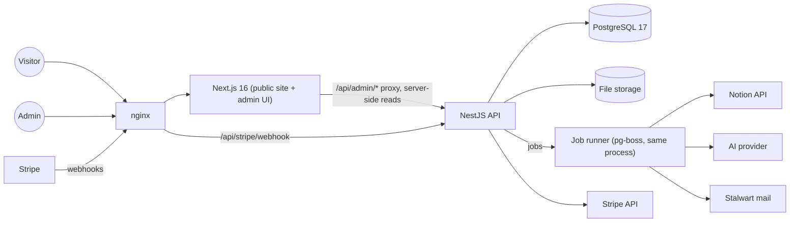

# Global Experiment — Architecture overview (v0.1, v1.0-ready)

Status: **proposed** (2026-10-15). This replaces the M1 overview, which
predated the NestJS API and the admin. Decisions with real trade-offs stay in
[`decisions/`](./decisions/) (ADRs); the database is specified in
[data-model.md](./data-model.md) and the build order in
[roadmap.md](./roadmap.md). Anything only the client can decide is listed in
[roadmap.md §5](./roadmap.md#5-open-questions-for-the-client) — this
document never assumes an answer to those.

**Sources of truth** used for this design (read 2026-10-15):

- Notion **"0.1 native"**: Treasury, Feedbacks and issues, Services, Access
  grants, Documentation, People, Organizations, Domains, Fields, Expertise
  and the Home page (schema, options and relations — the full mapping is in
  data-model.md). The legacy "Community" database is ignored.
- The Figma PDFs in `docs/design/figma/` (admin desktop, common pages,
  master, profile and account, signup and sign-in).
- The code: migrations 0000–0005, the NestJS modules, the importers, the
  admin shell.

**Client principle:** built the right way and ready to grow into v1.0, with
**no speculative features**. Every module below is something the v0.1 admin
sidebar or public site already shows; v1.0 items are named only as
extension points (§7), never built ahead.

## 1. System at a glance

- **One repository, two processes** (ADR [013](./decisions/013-nestjs-native-api.md)):
  the Next.js app renders every page and never touches the database; the
  NestJS API owns PostgreSQL, the business rules and every integration.
  The browser only ever talks to Next.js (same origin); Next.js proxies
  `/api/admin/*` to the API and reads public data from it server-side.
- **Modular monolith** (ADR [001](./decisions/001-modular-monolith.md)):
  one deployable API, one module per business area (§2), modules talk to
  each other only through exported services, never through each other's
  tables.
- **PostgreSQL is the system of record** for everything the admin edits.
  Notion is an import source (§4.1), not a live dependency, once a module
  is native (today only Home and Documentation are still read live).

## 2. Module map

Every module lives in `apps/api/src/<module>/` (schema, repository,
service, controllers, contracts, tests) and, for its admin screens, in
`src/modules/admin/<module>/`. "Owns" means only this module writes those
tables.

| Module | Purpose | Owns (tables) | API boundary | Admin pages (sidebar) | Public pages | Depends on |
|---|---|---|---|---|---|---|
| **Directory — People** | Contacts the experiment works with: state, source, follow-ups, contact details | `people`, `person_states`, `person_sources`, `people_organizations`, `people_expertise` | `/api/admin/people` | Admin → People (list, record) | none (never public) | Taxonomy, Organizations, Audit |
| **Directory — Organizations** | Organizations people belong to; expense recipients | `organizations`, `organization_expertise` | `/api/admin/organizations` | Other → Organizations | none | Taxonomy, People, Audit |
| **Taxonomy** | Domain → Field → Expertise vocabulary, teams | `expertise_domains`, `expertise_fields`, `expertise_items`, `teams`, `expertise_teams`, `taxonomy_statuses` | `/api/admin/expertise/*` (read-only in v0.1) | Other → Expertise, Fields, Domains | Expertise tags on documents and expenses | Imports |
| **Treasury** | Donations and expenses, review and publication, Stripe donations; Wise later | `treasury_entries`, `treasury_review_statuses`, `treasury_expense_types`, `treasury_entry_expense_types`, `treasury_documents`, `stripe_events` | `/api/admin/treasury/*`, public `/api/treasury/*`, `/api/donations/checkout`, `/api/stripe/webhook` | Admin → Treasury | `/treasury`, expense and donation detail, `/donate`, `/donate/thank-you` | People, Organizations, Files, Jobs, Audit |
| **CMS** | Home and Documentation content, editor, revisions | `documents` (Home is one of kind `home`), `document_statuses`, `content_revisions`, `document_expertise` | `/api/admin/cms/*`, public `/api/content/*` | Communication → Home, Documentation | `/`, `/documentation`, article and its history | Taxonomy, Audit, Imports |
| **Feedback and issues** | Public submissions, AI-assisted triage, decisions | `submissions`, `submission_types`, `submission_type_links`, `submission_statuses`, `submission_expertise` | public `POST /api/submissions`, `/api/admin/submissions` | Admin → Feedbacks and issues | Send feedback, Report issue composers | Taxonomy, AI, Jobs, Audit |
| **Waitlist** | Email sign-ups for the launch | `waitlist_entries` | public `POST /api/waitlist`, `/api/admin/waitlist` | Other → Waitlist | `/waitlist` | Email, People (link), Audit |
| **Messages (Contribute)** | Inbound mail to contribute@ / waitlist@ / donations@, linked to people | `mailboxes`, `mail_threads`, `mail_messages` | `/api/admin/messages` | Admin → Messages | `/contribute` (address only) | Email, People, Audit |
| **Emails** | Outbound email log and templates | `email_outbox` | internal service; `/api/admin/emails` (read) | Monitoring → Emails | none | Email integration, Jobs |
| **Services and access grants** | Which person holds which access to which tool | `services`, `access_grants`, `access_grant_statuses` | `/api/admin/services`, `/api/admin/access-grants` | Monitoring → Services, Access grants; People "Access grant" column | none | People, Audit, Imports |
| **Accounts and roles** | Admin identities, sessions, roles, permissions | `admin_users`, `admin_sessions`, `admin_roles`, `admin_permissions`, `admin_role_permissions`, `admin_invitations`, `admin_password_resets` | `/api/admin/auth/*`, `/api/admin/accounts` | Monitoring → Accounts; user card; Profile | `/admin/login` | People (optional link), Email, Audit |
| **Audit / History** | Who changed what, when; before/after | `audit_events` | written by every module's service; `/api/admin/history` (read) | Monitoring → History; History panel on record pages | none | — (used by all) |
| **Settings and module registry** | Module modes (notion / native), feature flags, import schedules; which modules are enabled | `settings` | `/api/admin/modules`, `/api/admin/settings` (owner), public `/api/config` (public flags only) | Settings (owner, from the user card); drives the sidebar | Donate page reads public flags | Audit |
| **Analytics** | Visitor statistics | none in PostgreSQL (lives in the analytics tool) | `/api/admin/analytics` (proxy of the tool's stats API) | Monitoring → Analytics | none (v1.0: Statistics page) | Analytics integration |
| **Technical dashboard** | Health of the stack, jobs, backups, integrations | none (reads health, `job` tables, `import_runs`) | `/api/admin/system` | Monitoring → Technical dashboard | none | all integrations, Jobs |
| **Imports** | Notion → PostgreSQL copies (dry run, apply, report) | `import_runs` | `/api/admin/imports/*` | People → Import Notion; Imports page | none | the modules it writes into |

Module notes:

- **Directory and Taxonomy** are built (migrations 0001–0005). The People
  "Access grant" and "Expenses" columns, and Figma's record "Access grant"
  / "Expenses" rows, come from Services and Treasury once those exist —
  read through those modules' services, not stored on `people`.
- **Treasury** is first in the build order (roadmap, due 24 October).
- **CMS** replaces the live Notion read of Home and Documentation: Notion's
  10 real articles and the Home page are imported into revisions and the
  public site reads the database. In v0.1 Notion stays their editing tool
  (§2.1); the admin editor is enabled at the module's v1.0 cut-over.
- **Messages and Emails** are one integration (Stalwart) with two admin
  views: inbound conversations, and the outbound delivery log.
- **Analytics and the Technical dashboard** have no tables of their own:
  they show data that lives elsewhere. Building storage for them would be
  speculative.
- **Platform** (settings, module registry, audit) is not a sidebar module:
  it owns `settings` and `audit_events` and serves every other module
  (§2.1, §2.2, §3.2).

### 2.1 Data ownership: Notion in v0.1, native in v1.0

Decided by the client on 2026-10-15 (answers Q1).

- **v0.1:** Notion is the **editing tool** for the Notion-backed modules —
  Directory (People, Organizations), Taxonomy, CMS Documentation and Home,
  Treasury **expenses**, Feedback and issues, Services and access grants.
  Their importers run **on demand** (admin, CLI) and **on a schedule**
  (a job per module, interval in settings).
- **v1.0:** the database and the admin are the **only** source; every
  importer is switched off.
- **Record-level origin.** Every importable table has
  `managed_by text not null` = `notion` | `native` (data-model §1), next to
  `notion_page_id`:
  - `notion` records are created and updated **only by their importer**.
    In the admin their **synced fields are read-only**, shown with a
    "Managed in Notion" badge and a link to the Notion page; fields Notion
    doesn't have (e.g. admin-only links, review metadata the module defines
    as native) stay editable. The API refuses writes to synced fields of a
    `notion` record (409 `managed_in_notion`), whatever the UI shows.
  - `native` records (created in the admin, Stripe donations and refunds,
    website submissions, waitlist entries, messages, audit events) are
    editable and **never touched by an importer** — an importer only reads
    and writes `notion` records and links between them.
- **Module mode.** Each Notion-backed module has a mode `notion` | `native`
  in the `settings` table (`module.<key>.mode`), shown and changed by the
  **owner** in the admin, audited. In `native` mode its importer refuses to
  run (on demand and scheduled) and every one of its records is `native`.

**v1.0 cut-over procedure** (per module, owner only, one at a time):

1. Announce a freeze: nobody edits the module's Notion database.
2. Run a **final import** (dry run, review, apply) and a second dry run
   that must report **0 changes**.
3. Take a database backup (as for a release).
4. **Switch the mode** in the admin: in one transaction the API sets
   `module.<key>.mode = native`, sets `managed_by = 'native'` on all the
   module's records, and moves each record-number identity past the highest
   number Notion used (`setval`) so new records never collide; one audit
   event records the switch.
5. Verify in the admin: the badge is gone and the records are editable;
   the importer button and schedule show "Native — import off".
6. Make the Notion database read-only (Notion permissions), as an archive.

Module specifics:

| Module | Cut-over notes |
|---|---|
| Directory | People and Organizations switch together (shared links); `person_number` / `org_number` identities moved past Notion's highest PER-n / ORG-n. |
| Taxonomy | Switch after Directory (links point to items); new items get Stable IDs in the admin (format checks already in the database). |
| CMS | Enables the admin editor (toolbar, revisions on Submit); the last imported revision becomes the current one. Home and Documentation can switch separately (`module.cms_home.mode`, `module.cms_documentation.mode`). |
| Treasury | Expenses switch; donations and refunds are always native (Stripe). Later, Wise sync writes native expense entries directly. |
| Feedback and issues | Notion-made submissions become native; website submissions were native from the start. |
| Services and access grants | Switch together (grants point to services). |

### 2.2 Flexible admin framework

So that a module or a field is added by configuration, not by a new screen:

- **Module registry.** Each module declares, in one registry entry: its
  sidebar entry (group, order, icon, label), its routes, the permissions
  each route needs, its mode setting (if Notion-backed) and its feature
  flags. The admin shell builds the sidebar from the registry plus
  `GET /api/admin/modules` (enabled state, mode, the user's permissions);
  a module that isn't enabled shows as **"Coming soon"** (today's
  behaviour, now data-driven).
- **Config-driven list pages.** Per module: columns (type — text, select,
  relation, date, number, money, boolean, tags; width; icon; default
  visibility), filters with their operators and option sources, sorts,
  saved views, the toolbar actions (New, Import Notion). The existing list
  engine (search, filter and sort popovers, column menu, freeze, resize,
  reorder, toasts) renders any config.
- **Config-driven record pages.** Per module: property rows (text,
  textarea, pills, pickers with limits and hints, dates, chips, read-only
  values), which fields are synced from Notion (read-only when
  `managed_by = notion`), the right panel (meta rows; Discard / Duplicate /
  Submit actions; custom actions such as Publish) and the History panel.
- **Adding a field** = a migration + an API contract field + one config
  entry. No new page code.
- **Settings and feature flags.** One `settings` table (key → JSON value,
  updated by, updated at; audited). Keys are declared in code with a type
  and an **environment default**, so a fresh install works without rows
  (e.g. `donations.monthly` = `DONATIONS_MONTHLY`, default off;
  `donations.extra_methods` (PayPal, SEPA) default off;
  `donations.default_currency` default USD; `module.<key>.mode`;
  `imports.<key>.schedule`). Public flags are exposed read-only to the
  public site; the owner edits them in the admin.
- **When:** built with module 2 (Audit/History, roadmap), which also
  refactors the existing People, Organizations and Taxonomy pages onto it.
  Until then Treasury uses the existing list/record components, and its
  flags read their environment defaults.

## 3. Cross-cutting concerns

### 3.1 Roles and permissions

v0.1 has one owner today ("Rootadmin" in the Figma History panel). The
sidebar's **Accounts** page implies more admins, and the designs name
team roles — Rootadmin, Superadmin, Moderator, Treasury admin, Operation
admin, Tech admin. Proposal — roles follow the experiment's six **teams**
(already a lookup, `teams`, from the taxonomy), plus the owner and a
general admin. "Superadmin" (a senior level within a team, which validates
applications and treasury transfers in the v1.0 designs) is a v1.0 team
membership level, not a v0.1 role:

| Role | Who | Notes |
|---|---|---|
| `owner` | Root admin (Candide) | Everything, including accounts and roles. Exactly one (existing partial unique index). |
| `admin` | General administrators | Everything except accounts/roles and destructive operations. |
| `treasury` | Treasury team | Treasury, Organizations/People read, Services read. |
| `communication` | Communication team | CMS, Waitlist, Messages, Emails read. |
| `moderation` | Moderation team | Feedback and issues, Messages. |
| `operations` | Operations team | People, Organizations, Services and access grants. |
| `tech` | Tech team | Technical dashboard, Imports, Services, History read. |
| `compliance` | Compliance team | Read access everywhere, History, Treasury review. |

Permissions are `module.action` keys stored as rows (`admin_permissions`),
granted to roles in `admin_role_permissions` — so a team's rights change
without a code release, and v1.0 can attach the same keys to team
memberships instead of roles. Actions: `read`, `create`, `update`,
`publish` (makes something public), `delete`, `import`, `manage`
(settings, vocabularies, accounts).

| Module \ role | owner | admin | treasury | communication | moderation | operations | tech | compliance |
|---|---|---|---|---|---|---|---|---|
| People, Organizations | all | read, create, update, import | read | read | read | read, create, update | read | read |
| Taxonomy | all | read, import | read | read | read | read | read, import | read |
| Treasury | all | read, create, update | read, create, update, **publish**, import | read | — | read | read | read, update (review) |
| CMS | all | all but manage | — | read, create, update, **publish** | read | — | read | read |
| Feedback and issues | all | read, update | — | read | read, update, **publish** | — | read | read |
| Waitlist | all | read, update | — | read, update | — | read | — | read |
| Messages, Emails | all | read, update | read (donations@) | read, update | read, update | read | read | read |
| Services, Access grants | all | read, create, update | read | — | — | read, create, update | read, create, update | read |
| Accounts and roles | **manage** | read | — | — | — | — | — | read |
| History | all | read | read (own module) | read (own module) | read (own module) | read (own module) | read | read |
| Technical dashboard, Imports | all | read, import | — | — | — | — | read, import | read |

The API enforces this with one guard (`@Requires('treasury.publish')`),
the admin hides what a role can't do, and every denied attempt is a 403
with an audit entry. Whether v0.1 needs more than the owner at all is
**Q8**; the schema is ready either way.

### 3.2 Audit log (History)

Figma's History panel (admin p6, p9, p12) shows, per record, entries like
"Candide · Rootadmin · updated · Aug 12 09:14" with the changed fields
before/after (struck-through old values, added/removed chips). One
append-only table serves it and the Monitoring → History page:

- `audit_events`: when, actor (admin user, or `system` / `import` /
  `stripe_webhook` / `job`), action (`create`, `update`, `delete`,
  `publish`, `unpublish`, `link`, `unlink`, `import`, `login`, `logout`,
  `permission_denied`), entity type + id, a **field-level diff**
  `{ field: { before, after } }`, and the request id.
- Written by each module's service **inside the same transaction** as the
  change (no change without its audit row, no audit row for a rolled-back
  change). Imports write one event per changed record, tagged with the
  import run.
- Never updated or deleted by the application (a database role without
  UPDATE/DELETE on the table in production); retention is **Q11**.
- Secrets and password hashes are never in a diff; private fields (personal
  notes, emails) are in the diff (the History page is admin-only) but never
  in logs.

### 3.3 Background jobs

Today imports run as in-memory jobs inside the API process (lost on
restart). Proposal: **pg-boss** (PostgreSQL-backed queue, no Redis, FOSS),
running in the API process for v0.1 (a separate worker process later
without code changes). Jobs:

| Job | Trigger | Notes |
|---|---|---|
| Notion import (each kind) | Admin action / CLI / **schedule** (`imports.<key>.schedule`) | Replaces the in-memory runner; result still in `import_runs`; refused when the module is `native` (§2.1). |
| Stripe event processing | Webhook stores the event, job processes it | The webhook answers Stripe fast; processing is idempotent (`stripe_events`). |
| Stripe fee reconciliation | Every 15 min | Fills fee/net when Stripe's balance transaction wasn't ready. |
| AI triage of a submission | On submission | Translation, significance score, note, bot score (§4.5). |
| Outbound email | On demand | Waitlist confirmation, acknowledgements; retried with backoff. |
| Inbound mail sync | Every few minutes (or push) | Stalwart → `mail_messages`. |
| Backups check | Daily | Reports the last backup's age and size to the dashboard. |

Every job is retried with backoff, has a dead-letter state shown on the
Technical dashboard, and never holds secrets in its payload.

### 3.4 File storage

Treasury supporting documents (invoices, receipts) are the only uploads in
v0.1. Behind a `FileStorage` interface (`put`, `get`, `delete`, `exists`):

- **v0.1 adapter: local disk** on the VPS (`/var/lib/global-experiment/files`,
  outside every web root, owned by the API user), named by SHA-256, served
  only through an authenticated API route with `Content-Disposition:
  attachment`. Included in the backup.
- Later: an S3-compatible adapter (e.g. Hetzner Object Storage) with no
  schema change — the table stores a `storage_key`, not a path.
- Limits: 20 MB, PDF / PNG / JPEG only, checked by content sniffing, not
  just the extension. Retention (accounting law usually 10 years) is **Q5**.

### 3.5 AI layer

Used only for **feedback and issue triage** (Notion's "AI note", "AI
significance score", "Bot score", "Translation"). Behind an `AiProvider`
interface (`translate`, `assess`), one adapter per provider; the provider
is **Q12**. Rules: AI output is stored as a suggestion next to the human
value (e.g. `ai_significance_score` vs `significance_score`) and never
decides anything on its own; the model, prompt version and time are stored
with each result; personal data is not sent beyond the submission text; a
provider outage leaves the submission untriaged, never lost. No AI in
imports (data-model §5).

### 3.6 Email

**Stalwart** (self-hosted, JMAP + SMTP) holds the mailboxes `contribute@`,
`waitlist@` and `donations@` (already published on the site). Behind an
`MailProvider` interface: outbound via SMTP submission, inbound via JMAP.
Outbound messages go through `email_outbox` (queued → sent / failed,
retried), so the Emails page shows real delivery state. SPF, DKIM and DMARC
on globalexperiment.org are a deployment prerequisite. Donation receipts
are sent by Stripe, not by us (no donor email stored, §3.8).

### 3.7 Caching and revalidation of public pages

| Page | Data | Freshness |
|---|---|---|
| Home, Documentation, articles | CMS (published revisions) | Cached; revalidated **on publish** (the API calls a Next.js revalidation route with a shared secret, `revalidateTag`). |
| Treasury, Donate stats | Treasury summary and entries | Revalidated **on demand** whenever an entry is created, changed or published (the API calls the Next.js revalidation route), with a **5-minute** time-based fallback (decided, Q4). |
| Expense / donation detail | One published entry | Cached 5 minutes; 404 when unpublished. |
| Waitlist, feedback composers | — | Not cached (forms). |

Public API responses carry no personal data, so caching them is safe.

### 3.8 Privacy rules (never public)

- **Directory:** nothing from `people` or `organizations` is public, except
  an organization's or person's **name** as an expense recipient when the
  client confirms it (**Q3**).
- **Treasury:** `internal_note`, `source_account_id`, recipient Wise IDs,
  documents, unpublished entries and review details are never public.
  Donations carry **no donor data** at all (Stripe holds it).
- **Feedback:** submission text, locale, AI output and scores are private;
  only a `public_summary` can be published, never for a submission marked
  confidential (security reports are always confidential).
- **Waitlist, Messages, Emails, Access grants, Accounts, History:** never
  public.
- **Logs:** no personal data, tokens or request bodies; ids only.

### 3.9 Errors and logging

Kept as built: typed `ApiError` codes with stable JSON error bodies and a
request id; structured JSON logs (pino) with the request id; Next.js error
boundaries for the public site. Added: job failures and integration errors
are logged with the job/run id and surfaced on the Technical dashboard;
optional error tracking (self-hosted GlitchTip) is **Q14**.

## 4. Integrations

All provider code sits behind an interface in `apps/api/src/integrations/`
(ADR [004](./decisions/004-server-side-secrets.md): secrets server-side
only, validated at startup).

| Integration | Used by | Direction | Notes |
|---|---|---|---|
| **Notion** | Imports (Directory, Taxonomy, Treasury expenses, CMS, Feedback, Services) | read-only | The **editing tool in v0.1** (§2.1): importers on demand and on a schedule, writing only `managed_by = notion` records; switched off per module at the v1.0 cut-over. Dry run → report → apply; demo records skipped; idempotent. Home and Documentation are read live until the CMS module ships. |
| **Stripe** | Treasury (donations) | both | Hosted Checkout, one-off; **monthly behind the `donations.monthly` flag (off)**, no yearly; webhooks with signature check, exactly-once processing, refunds as negative entries, fees from balance transactions; Stripe sends the email receipts. Test mode until the client says otherwise. |
| **Wise** | Treasury (later) | read | Balance and statement sync into `treasury_entries` (`source = wise`), then payouts in v1.0. Not in v0.1 unless asked. |
| **Stalwart** | Messages, Emails, Waitlist | both | JMAP inbound, SMTP outbound. |
| **AI provider** | Feedback and issues | out | Translation and assessment, behind `AiProvider`. |
| **Analytics** (Plausible or Matomo, **Q13**) | Analytics page | read | The admin page reads the tool's stats API; the site loads its script. |

## 5. Deployment and operations

- **Environments:** local (developer machine, PostgreSQL 17 on 5433, `*_dev`
  database), test (`*_test` databases, wiped by the test runs), production
  (Hetzner VPS). A staging environment is **Q15** (proposal: a second
  database and API port on the same VPS, deployed from `develop` before
  `main`).
- **Processes:** nginx → `global-experiment.service` (Next.js, :3000) and
  `global-experiment-api.service` (NestJS, :4000), PostgreSQL 17, Stalwart
  (when the email module ships). Configuration only from
  `/etc/global-experiment/*.env`.
- **Migrations:** Drizzle SQL files, reviewed in the pull request, applied
  explicitly on release (`db:migrate` with the production env), each in one
  transaction, after a verified backup — as in the release runbooks in
  `docs/operations/`.
- **Backups:** today manual per release. Proposal: nightly `pg_dump` (custom
  format) + the file store, kept 30 days on the VPS and copied off-site
  (Hetzner Storage Box), with a monthly restore test into a scratch
  database; the Technical dashboard shows the last backup.
- **Monitoring:** external uptime check of `/`, `/api/health` and the admin
  login; journald logs; disk and backup-age alerts; Stripe webhook failures
  and dead jobs on the Technical dashboard.
- **Release process:** feature branch → merge commit into `develop` → full
  suite → push to the client repo → deploy with the runbook (backup,
  build, `chown .next`, migrate, restart, health checks, verification,
  record of the run). Production currently deploys `develop`; deploying
  tagged releases from `main` is **Q15**.

## 6. Security summary

Owner/admin sessions as in ADR [014](./decisions/014-owner-admin-authentication.md)
(server-side sessions, HttpOnly cookies, CSRF origin check, login
throttling). Public write endpoints (submissions, waitlist, checkout) are
rate-limited per IP, size-limited, validated with Zod, and protected
against bots (honeypot field + the AI bot score; a CAPTCHA only if
abuse appears). Stripe webhooks are verified by signature on the raw body.
The database user of the API has no superuser rights; the audit table is
append-only for it.

## 7. v1.0 extension points

v1.0 (Figma "Signup and signin", "Profile and account", the Master file)
adds participant accounts, profiles, teams, participation and governance.
Today's design leaves these seams, so nothing is reworked:

| v1.0 capability | Seam in v0.1 | How it extends |
|---|---|---|
| **Participant accounts** (signup, email validation, password reset) | `admin_users` stays the staff identity | New `accounts` table for participants; an admin who is also a participant links `admin_users.account_id`. Email templates already go through `email_outbox`. |
| **Profiles** (bio, demographics, expertise, alignment / participation / diversity) | Taxonomy links are already "entity ↔ expertise item" tables | `profiles` (1:1 with `accounts`), `profile_expertise` on the same `expertise_items`; coefficients in their own versioned tables. |
| **Teams and admin applications** ("Join admin") | `teams` lookup, role keys = team keys, permissions as rows | `team_memberships(account, team, role)` reuse the permission keys; applications are a new table with the audit log. |
| **Donor identity** (named donations, "recurring donation since …") | Donations have no donor columns | A nullable `donor_account_id` on `treasury_entries` once accounts exist and the donor opts in; anonymous stays the default. |
| **Wise sync and payouts** | `treasury_entries.source = wise`, unique `(source, external_transaction_id)` | A Wise adapter writes entries idempotently; payouts get their own table linked to expense entries. |
| **Participation** (dailies, votes, comments) and **governance** (proposals, roadmap) | Feedback `Roadmap item` status; CMS revisions; audit log | New modules with their own tables; feedback can link to roadmap items. |
| **Public statistics** | Treasury summary endpoint, analytics integration | A Statistics page reading the same public endpoints. |
